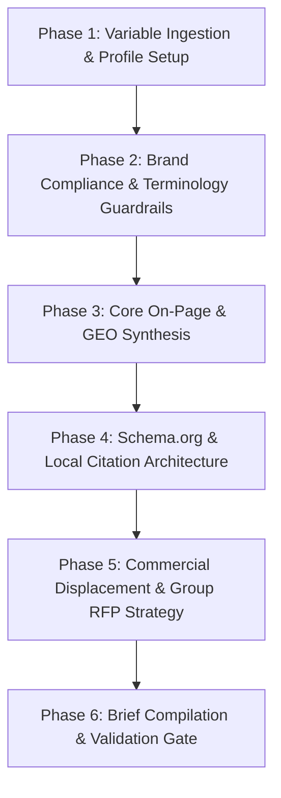

# New Hotel SEO & GEO Client Brief Workflow

This workflow orchestrates the generation of an enterprise-grade, brand-compliant Search Engine Optimization (SEO) and Generative Engine Optimization (GEO) brief for a hotel property. It pulls modular components from the `templates/` directory, resolves property-specific variables, enforces brand compliance guidelines (Marriott, Hilton, IHG, Hyatt), and synthesizes a turnkey client brief ready for deployment.

---

## 1. Required Input Variables

Before executing this workflow, collect or provide the following property attributes:

| Variable | Description | Example |
|---|---|---|
| `hotelName` | Official property trade name | `The Westin Peachtree Plaza, Atlanta` |
| `brand` | Brand collection and parent company | `Westin / Marriott International` |
| `city` | Host city | `Atlanta` |
| `state` | State or province two-letter code | `GA` |
| `primaryKeyword` | Primary non-brand local search term | `downtown Atlanta hotel near AmericasMart` |
| `targetHub` | High-intent proximity landmark or convention center | `Georgia World Congress Center` |
| `propertyTier` | Market tier (Luxury, Upper Upscale, Select Service, Extended Stay) | `Upper Upscale` |
| `canonicalUrl` | Preferred canonical domain and path | `https://www.marriott.com/hotels/travel/atlpl-the-westin-peachtree-plaza-atlanta/` |
| `loyaltyProgram` | Applicable guest loyalty program | `Marriott Bonvoy` |

---

## 2. Phased Workflow Execution

### Phase 1: Property Profile Setup & Variable Ingestion
1. Ingest all property parameters (`hotelName`, `brand`, `city`, `state`, `primaryKeyword`, `targetHub`, `canonicalUrl`, `loyaltyProgram`).
2. Verify against `templates/sample-data.json` or live property intake sheet to ensure no required placeholders remain null.

### Phase 2: Brand Compliance & Terminology Guardrails
1. Inspect `templates/brand-compliant-hotel-onpage.md`.
2. Check the parent brand against restricted terminology rules:
   - **Marriott Bonvoy**: Enforce exact trademark capitalization; replace "free breakfast" with "Complimentary hot breakfast" or brand standard terms.
   - **Hilton / Hilton Honors**: Verify digital key, connected room terminology, and brand typography restrictions.
   - **IHG One Rewards**: Validate tier nomenclature and brand-approved amenity tags.
   - **World of Hyatt**: Restrict unauthorized superlative claims ("best hotel") and ensure reward night redemption phrasing aligns with program terms.
3. Validate metadata pixel-width limits:
   - Title tag: 580px desktop ceiling (approx. 55–60 characters).
   - Meta description: 920px mobile/desktop ceiling (approx. 145–158 characters).

### Phase 3: Core On-Page & GEO Synthesis
1. Extract modular on-page layouts from `templates/brand-compliant-hotel-onpage.md`:
   - Title Tag & Meta Description.
   - H1–H3 Content Hierarchy.
   - Standardized Room & Amenity Feature blocks with accessible image alt text.
2. Ingest generative search triggers from `templates/hotel-geo-ai-visibility.md`:
   - Property entity definition engineered for LLM context windows (Gemini, ChatGPT Search, Perplexity).
   - Conversational prompt test matrix (business travel, group event, family stay).
   - High-density Q&A block answering factual spatial, parking, pet, and dining queries.

### Phase 4: Schema.org & Local Citation Architecture
1. Extract JSON-LD modules from `templates/hotel-lodging-schema.md`:
   - Composed `@graph` containing `Hotel` / `LodgingBusiness`, `HotelRoom`, `FAQPage`, and `AggregateRating`.
   - Precise `geo` coordinates, `checkinTime` / `checkoutTime`, and authoritative `sameAs` entity references (Wikidata, Google Maps place URL).
2. Cross-reference `templates/hotel-gbp-unap-audit.md`:
   - Verify Unified Name, Address, Phone, and URL (UNAP) consistency across Google, TripAdvisor, Apple Maps, and OTA listings.
   - Formulate 30-day GBP update and review response action plan.

### Phase 5: Commercial Displacement & Group RFP Strategy
1. Integrate direct-booking value props from `templates/direct-booking-ota-displacement.md`:
   - Transparent price match guarantee and flexible cancellation micro-copy.
   - Loyalty point bonus promotions and exclusive direct booking amenities.
2. Integrate venue capacity specifications from `templates/hotel-meetings-events-rfp.md`:
   - Ballroom square footage, ceiling heights, and banquet/reception/classroom capacities.
   - Planner-focused AV and catering terms with RFP submission pathway.

### Phase 6: Final Brief Compilation & Quality Verification
1. Assemble all compiled sections into a unified client brief at `briefs/{{propertySlug}}-seo-brief.md`.
2. Run SEO validation gates:
   - **Variable Resolver**: Confirm zero uncompiled `{{variableName}}` markers.
   - **XSS Sanitizer**: Ensure all attributes and schema tags are clean.
   - **Canonical Normalizer**: Confirm HTTPS and clean parameter-free URLs.
   - **Robots Guardrails**: Verify indexable directives.

---

## 3. Workflow Output Checklist

The finalized client SEO brief must contain:
- [ ] Executive Summary with Primary Entity Positioning
- [ ] Brand Compliance & Restricted Terminology Guidelines
- [ ] On-Page Metadata Matrix (Title, Meta Description, H1, H2s, H3s)
- [ ] Generative Engine Optimization (GEO) Structured Q&A Block
- [ ] Complete Copy-Pasteable JSON-LD Schema (`@graph`)
- [ ] Google Business Profile Category & UNAP Consistency Matrix
- [ ] Direct Booking Value Proposition & OTA Displacement Snippets
- [ ] Venue Capacity Chart & Group Sales RFP Section
- [ ] 30/60/90 Day Implementation & Review Response Roadmap
