# Implementation Roadmap — Cogwheel Enterprise Platform
**Date:** 2026-11-23  
**Document:** `AUDIT/IMPLEMENTATION-ROADMAP.md`  
**Execution Strategy:** Continuous Checkpoint Delivery (Checkpoints A – I)  

---

## Roadmap Phases & Milestones

```mermaid
flowchart LR
    CP_A["Checkpoint A: Audit & Inventory"] --> CP_B["Checkpoint B: Foundation & UI System"]
    CP_B --> CP_C["Checkpoint C: Property & Keywords Engine"]
    CP_C --> CP_D["Checkpoint D: SEO Intelligence & Content"]
    CP_D --> CP_E["Checkpoint E: Growth & GEO Intelligence"]
    CP_E --> CP_F["Checkpoint F: AI Agent Swarm & Orchestration"]
    CP_F --> CP_G["Checkpoint G: Reporting & Exports Studio"]
    CP_G --> CP_H["Checkpoint H: Enterprise RBAC & Security"]
    CP_H --> CP_I["Checkpoint I: Final Verification & Handover"]
```

---

## Checkpoint Breakdown & Deliverables

### Checkpoint A — Audit & Foundation Review (COMPLETED ✅)
- [x] Initial full-codebase audit (`AUDIT/INITIAL-AUDIT.md`)
- [x] Architecture review and target blueprint (`AUDIT/ARCHITECTURE-REVIEW.md`)
- [x] Comprehensive 33-feature inventory matrix (`AUDIT/FEATURE-INVENTORY.md`)
- [x] Implementation roadmap and dependency graph (`AUDIT/IMPLEMENTATION-ROADMAP.md`)

### Checkpoint B — Enterprise UI/UX Design System & Shared Services
- [ ] Build reusable enterprise UI components: Header/TopNav, Breadcrumbs, MetricKPI cards, Data tables with pagination & sorting, Alert banners, Status badges.
- [ ] Refactor `PropertyDashboard.tsx` to cleanly separate sub-views and eradicate oversized inline markup.
- [ ] Implement robust error boundary, toast notification system, and empty/loading states.
- [ ] Ensure full compliance with GEMINI.md semantic HTML5 rules (`<header>`, `<nav>`, `<main>`, `<article>`, `<aside>`, `<footer>`).

### Checkpoint C — Multi-Client Management, Crawling & Keyword Engine
- [ ] Build Client & Organization layer: `ClientManager` allowing agencies to manage multiple hotel brands and client portfolios.
- [ ] Implement dynamic property CRUD with brand templates (Hilton, Marriott, IHG, Hyatt, Independent Boutique).
- [ ] Expand Crawler engine: Deep link discovery, page classification (Home, Rooms, Dining, Meetings, Local, Booking, FAQ), and crawl state persistence.
- [ ] Extend keyword intelligence: Competitor keyword gap analysis (`compsets-keywords-analysis`), ranking tracking (`keyword-ranking-report-comp-set`), and cannibalization detector.

### Checkpoint D — SEO Intelligence & Hilton Content Studio
- [ ] Implement `sitemap-navigation-optimization` task: XML sitemap generator, crawl depth analysis, orphan page detector.
- [ ] Implement `site-tech-re-audit-report` task: Delta comparator between initial audit baseline and current crawl state.
- [ ] Enhance Hilton Content Studio: Strict diff mode, ADA checks, forbidden word scanner, character budgeting, and Google Doc export.
- [ ] Expand JSON-LD Schema Studio: Validates against Schema.org specs and Google Rich Results eligibility for Hotel, LodgingBusiness, Restaurant, Event, FAQPage.

### Checkpoint E — Growth Intelligence: Competitors, Backlinks & GEO
- [ ] Build Off-Page / Backlink module:
  - Implement `internal-kickoff-strategy-list` task.
  - Implement `email-outreach-formatting` task for hospitality partnerships.
  - Implement `competitors-backlink-analysis` task.
  - Implement `backlinking-strategy-execution` task.
- [ ] Build Local SEO module:
  - Implement `google-map-citation` task with NAP consistency validation across major directories.
- [ ] Build Advanced GEO / AI Search Intelligence Center:
  - Implement prompt runner for ChatGPT Search, Google AI Overviews, and Perplexity.
  - Record verified citation URLs, brand sentiment, competitor mentions, and transparent scoring calculation.

### Checkpoint F — AI Agent Swarm & End-to-End Orchestration
- [ ] Implement 13 specialized AI agents:
  1. Audit Agent, 2. Keyword Research Agent, 3. Keyword Mapping Agent, 4. On-Page SEO Agent,
  5. Technical SEO Agent, 6. Content Optimization Agent, 7. Schema Validation Agent, 8. Local SEO Agent,
  9. Competitor Analysis Agent, 10. Backlink Analysis Agent, 11. GEO Research Agent, 12. Reporting Agent,
  13. QA Verification Agent.
- [ ] Build 26-step unified pipeline orchestrator with dependency tracking, pause/resume, and human approval gates.

### Checkpoint G — Advanced Reporting, BI & Multi-Format Exports
- [ ] Implement `ai-seo-visibility-report` (Quarterly Executive PPTX).
- [ ] Implement `final-seo-geo-project-report` (Complete deliverable doc).
- [ ] Build interactive BI dashboard with date range comparisons, monthly trends, and property benchmarks.
- [ ] Validate and expand exports: PPTX, PDF, CSV, XLSX, HTML, Shopify Liquid, WordPress PHP, Webflow CSV.

### Checkpoint H — Enterprise Readiness, RBAC, Security & Integrations
- [ ] Implement Role-Based Access Control (RBAC): `Administrator`, `Manager`, `SEO Specialist`, `Content Editor`, `Analyst`, `Read-only Client`.
- [ ] Implement tenant-scoped RLS and client-level data isolation.
- [ ] Build Integration Status Manager: Real API ping checks for GSC, GA4, PageSpeed, GBP, Semrush, Ahrefs, Anthropic, Supabase.
- [ ] Run security hardening: Input sanitization, SSRF tests, XSS audit, and rate limiting.

### Checkpoint I — Final Verification, Acceptance Testing & Handover
- [ ] Run full test suites: Vitest, Python tests, schema validators, Next.js production build.
- [ ] Create `AUDIT/FINAL-REPORT.md`, `AUDIT/FEATURE-STATUS.md`, `AUDIT/SECURITY-REPORT.md`, `AUDIT/TEST-RESULTS.md`, `AUDIT/INTEGRATION-STATUS.md`.
- [ ] Update `README.md`, `SPEC.md`, `INVENTORY.md`.
