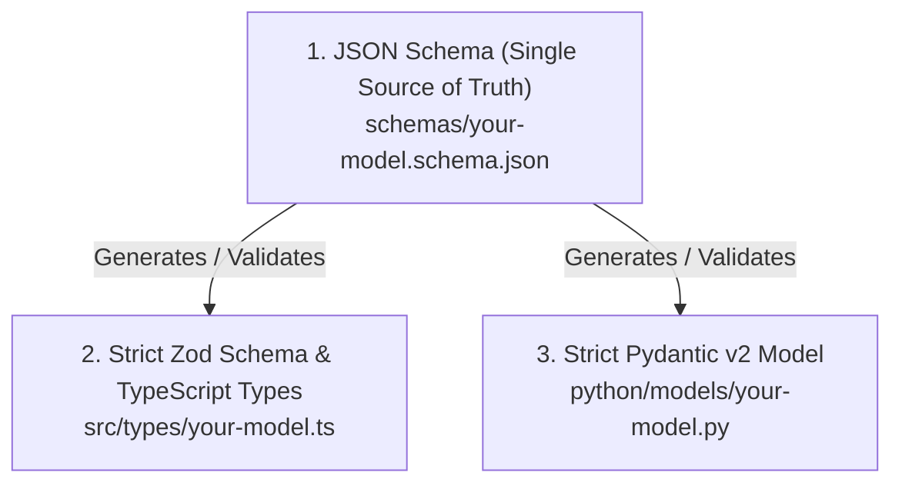

# Contributing to Cogwheel SEO Studio

Thank you for contributing to **Cogwheel SEO Studio**! This project provides a production-grade, AI-powered SEO automation and audit platform spanning Next.js, Chrome Extensions (Manifest V3), and Python analysis engines.

To maintain strict reliability, security, and type safety, we follow the **GSD (Get Shit Done) Methodology** and enforce strict architectural guardrails.

---

## Core Principles

1. **Plan Before You Build** — All data structures originate from a Single Source of Truth (`schemas/*.schema.json`).
2. **Zero `any` Types** — Full static type safety in TypeScript (`@typescript-eslint/no-explicit-any: error`) and Python (Pydantic v2 `extra="forbid", strict=True` + Mypy).
3. **Verify Empirically** — Every change requires automated tests proving correctness before merging.
4. **Zero Secret Leakage** — Pre-commit hooks block API keys, tokens, or credentials from being committed.

---

## Git Workflow & Branching Strategy

We use a feature-branch workflow aligned with Continuous Integration:

| Branch | Purpose | Protection | Deployment |
|---|---|---|---|
| `main` | Production-ready stable code | Protected; PR required | Auto-deploys to Vercel on pass |
| `feat/<name>` | New capabilities, templates, schemas | Short-lived | Validated via CI |
| `fix/<name>` | Bug fixes and schema corrections | Short-lived | Validated via CI |
| `perf/<name>` | Performance optimizations | Short-lived | Validated via CI |
| `docs/<name>` | Documentation improvements | Short-lived | Validated via CI |

---

## Commit Message Standard (Conventional Commits)

All commits **must** adhere to the [Conventional Commits v1.0.0](https://www.conventionalcommits.org/) specification. This format is enforced locally by the `.husky/commit-msg` hook:

```
<type>(<scope>): <subject>
```

### Allowed Types

- `feat`: A new feature, audit tool, or schema model.
- `fix`: A bug fix or schema correction.
- `docs`: Documentation updates or additions.
- `style`: Visual styling, theme updates, or formatting changes.
- `refactor`: Code reorganization with zero functional changes.
- `perf`: Code changes that improve speed or memory usage.
- `test`: Adding or updating test suites.
- `build`: Build system or external dependency updates.
- `ci`: CI/CD workflow configuration updates.
- `chore`: Tooling, configs, or administrative changes.
- `revert`: Reverting a previous commit.

### Good Commit Examples

```bash
feat(schemas): add hotel-seo schema and strict Pydantic v2 model
fix(extension): correct DOM image alt detection for lazy-loaded assets
docs(git): document branch conventions and conventional commits
test(hotel-seo): add boundary check test cases for entityDensityScore
refactor(linter): streamline 10-gate SEO validation runner
```

---

## Single Source of Truth & Type Architecture

When introducing or modifying data models, you must update all three layers:



1. **JSON Schema** (`schemas/*.schema.json`):
   - Defined in JSON Schema Draft-07.
   - Requires `additionalProperties: false` and strict `required` fields.
2. **TypeScript / Zod** (`src/types/*.ts`):
   - Strict Zod schemas with `.strict()`.
   - Inferred types exported without `any`.
3. **Python / Pydantic v2** (`python/models/*.py`):
   - Pydantic models with `model_config = ConfigDict(extra="forbid", strict=True)`.
   - Compatible type hints across Python 3.9 through 3.13+.

---

## Local Development & Pre-Commit Setup

Install dependencies and activate Git hooks:

```bash
# Install Node.js dependencies
npm install

# Activate Husky Git hooks
npx husky

# Make hooks executable
chmod +x .husky/pre-commit .husky/commit-msg
```

---

## Local Verification Commands

Before creating a commit or opening a Pull Request, run the complete verification suite:

```bash
# 1. Type Check Root & Extension TypeScript
npm run typecheck
cd chrome-extension && npx tsc --noEmit && cd ..

# 2. Run ESLint (Enforces Zero 'any' types)
npx eslint src/ tests/

# 3. Run All TypeScript Tests & 10-Gate SEO Linter
npm run test:seo

# 4. Run Python Linting & Type Checking
ruff check python/ scripts/python/ outputs/ tests/python/
mypy python/ scripts/python/

# 5. Run Python Test Suite
python3 tests/python/run_tests.py
pytest tests/python/

# 6. Validate Single Source of Truth Schemas
python3 scripts/python/validate_schemas.py

# 7. Production Next.js Build
npm run build
```

---

## Pull Request Guidelines

1. **Keep PRs Focused**: Avoid bundling unrelated refactors with functional changes.
2. **Fill Out the PR Template**: Complete all checklist items in `.github/pull_request_template.md`.
3. **Zero Warnings Policy**: Ensure CI Suite passes with 0 lint, type, or test errors.
4. **Sign-off**: Review and respect source attributions documented in `ATTRIBUTION.md`.
