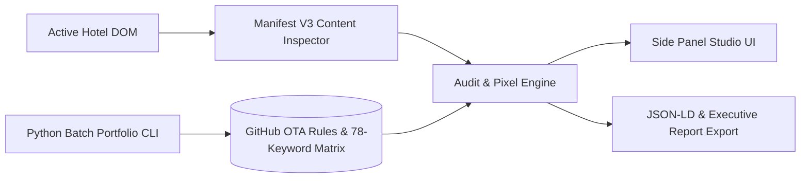

<div align="center">
  <h1>Cogwheel SEO & GEO Studio</h1>
  <p><strong>Enterprise Hospitality Search & Generative Engine Optimization (GEO) Suite</strong></p>
  <p>
    <a href="https://github.com/jisan-razibmarketing/Cogwheel-SEO-Templates/actions"></a>
    
    
    
    
  </p>
</div>

---

## Overview

**Cogwheel SEO & GEO Studio** is a production-grade Chrome Side Panel inspector, template engine, and batch auditing pipeline built for multi-property hospitality portfolios (**Marriott, Hilton, IHG, Hyatt, and Independent Luxury Hotels**).

### Core Capabilities
- **Real-Time SERP Pixel Engine**: Exact Arial `20px` (`580px` title) and `14px` (`920px` meta description) pixel-width budgeting with Desktop, Mobile, and Social Open Graph previews.
- **Brand-Compliant Guardrails**: Automated enforcement of franchised brand rules, prohibited superlatives, and mandatory suffix structures.
- **JSON-LD & Entity Graph Generator**: One-click `Hotel`, `LodgingBusiness`, `FAQPage`, `EventVenue`, and `sameAs` structured data injection.
- **GEO AI Readiness Scoring**: Evaluates property pages for citation readiness across ChatGPT, Google Gemini, and Perplexity.
- **Zero-Maintenance OTA Rule Sync**: Background Manifest V3 service worker automatically syncs updated keyword matrices and brand rules from GitHub.

---

## System Architecture



---

## Project Structure

```
Cogwheel-SEO-Templates/
├── chrome-extension/              # Production Manifest V3 Chrome Extension
│   ├── public/                    # Extension static assets & manifest.json
│   ├── src/
│   │   ├── background/            # Service worker & GitHub 2-layer auto-updater
│   │   ├── components/            # Studio, Overlays, Batch, Settings, Gauges
│   │   ├── content/               # 1-click DOM context extractor & visual overlays
│   │   ├── data/                  # Pre-compiled hospitality templates & audit rules
│   │   ├── sidepanel/             # Chrome Side Panel inspector application
│   │   ├── types/                 # Strict TypeScript contracts & update schemas
│   │   └── utils/                 # Arial pixel width engine & URL security
│   └── package.json
├── data/                          # Shared data & live sync assets
│   ├── 78-keyword-strategy-matrix.json  # 78 hospitality SEO/GEO keyword dataset
│   └── ota-config.json            # Live OTA rules, pixel thresholds & scoring weights
├── templates/                     # Production Markdown & HTML templates
│   ├── brand-compliant-hotel-onpage.md
│   ├── hotel-geo-ai-visibility.md
│   ├── hotel-gbp-unap-audit.md
│   ├── hotel-lodging-schema.md
│   ├── direct-booking-ota-displacement.md
│   ├── local-proximity-destination-guide.md
│   ├── hotel-meetings-events-rfp.md
│   ├── hotel-opening-flag-change-seo.md
│   ├── multi-property-cannibalization-matrix.md
│   ├── hotel-destination-guide.html
│   ├── hotel-room-showcase.html
│   └── hotel-faq-amenities.html
├── schemas/                       # Composable JSON-LD @graph Builders
│   ├── article.ts                 # Schema.org Article
│   ├── product.ts                 # Schema.org Product (Offer + AggregateRating)
│   ├── faqPage.ts                 # Schema.org FAQPage (Question + Answer)
│   ├── localBusiness.ts           # Schema.org Hotel / LodgingBusiness
│   ├── breadcrumbList.ts          # Schema.org BreadcrumbList
│   └── graphBuilder.ts            # Unified @graph composer
├── validators/                    # Core Quality & Security Gates
│   ├── variableResolver.ts        # Strict template compiler, fallbacks & leak scanner
│   ├── xssProtection.ts           # Context-aware HTML & attribute sanitization
│   ├── canonicalNormalizer.ts     # Protocol enforcer, query cleaner & slash normalizer
│   ├── robotsGuardrails.ts        # Env-aware robots & production noindex blocker
│   ├── serpOptimizer.ts           # Typography character width lookup & title trimmer
│   ├── uniquenessGate.ts          # N-gram & Jaccard similarity scorer (>70% duplicate block)
│   └── internalLinker.ts          # Manifest-driven semantic contextual linker
├── exporters/                     # Multi-CMS Export Adapters
│   ├── htmlExporter.ts            # Clean HTML5 with metadata & minification
│   ├── shopifyExporter.ts         # Shopify Liquid snippets (.liquid) & sections
│   ├── wordPressExporter.ts       # WordPress PHP partials & Yoast/RankMath mapper
│   └── webflowExporter.ts         # Webflow Collection CSV & rich-text exporter
├── tests/                         # Automated Regression & Linter Suite
│   ├── auto-updater.test.ts       # SemVer comparison & auto-update test suite
│   ├── cogwheel-optimal-audit.test.ts # 100/100 4-gauge optimal score verification
│   ├── variableResolver.test.ts
│   ├── securityGuardrails.test.ts
│   ├── schemas.test.ts
│   ├── serpOptimizer.test.ts
│   └── seoLinter.ts               # Master 10-Gate SEO Quality Checker
├── .github/workflows/             # Continuous Integration Pipelines
│   ├── auto-release.yml           # Automated extension build, zip, & release pipeline
│   └── seo-integrity.yml          # GitHub Actions automated linter & secret scanner
├── updates.xml                    # Enterprise / CRX auto-update manifest
├── llms.txt                       # Machine-readable AI crawler documentation index
└── package.json                   # Root scripts and workspace dependencies
```

---

## Chrome Extension Setup

### Installation (Developer Mode)
1. Clone the repository:
   ```bash
   git clone https://github.com/jisan-razibmarketing/Cogwheel-SEO-Templates.git
   cd Cogwheel-SEO-Templates
   ```
2. Build the extension bundle:
   ```bash
   cd chrome-extension
   npm ci
   npm run build
   ```
3. Open Google Chrome and navigate to `chrome://extensions/`.
4. Toggle **Developer mode** in the top-right corner.
5. Click **Load unpacked** and select the `chrome-extension/dist` folder.
6. Open any hotel website or property URL and click the Cogwheel extension icon to launch the Side Panel.

### Two-Layer Free Auto-Update System
- **Layer A (Silent OTA Live Sync)**: `chrome.alarms` triggers background synchronization every 6 hours, fetching the latest keyword matrices, scoring weights, and brand guardrails from GitHub `main` and caching them in `chrome.storage.local`.
- **Layer B (Extension Binary Checker)**: Verifies the remote `manifest.json` version against the local installation and sets an action badge (`NEW`) with an in-app banner for 1-click update archive downloads.

---

## Master Template Catalog & Index

The studio includes 9 production Markdown templates and 3 HTML component templates engineered for hospitality SEO, Generative Engine Optimization (GEO), and multi-property portfolio management:

| Template | Category | Primary SEO / GEO Use Case | Target Search Engines |
|---|---|---|---|
| [`brand-compliant-hotel-onpage.md`](templates/brand-compliant-hotel-onpage.md) | Content & On-Page Architecture | Brand.com on-page copy complying with strict character caps and restricted terminology across Marriott, Hilton, IHG, and Hyatt. | Google SERP, Bing, Google Gemini, ChatGPT Search, Perplexity Pro |
| [`hotel-geo-ai-visibility.md`](templates/hotel-geo-ai-visibility.md) | AI Search & GEO Optimization | Generative Engine Optimization via high-density entity positioning, conversational traveler prompt testing, and structured Q&A. | Google Gemini, ChatGPT Search, Perplexity Pro, Google AI Overviews |
| [`hotel-gbp-unap-audit.md`](templates/hotel-gbp-unap-audit.md) | Local SEO & Citation Audit | UNAP consistency auditing across Google, TripAdvisor, Apple Maps, and OTAs, plus 30-day GBP update and review response workflows. | Google Maps, Google Local Pack, Apple Maps, TripAdvisor, Bing Places |
| [`hotel-lodging-schema.md`](templates/hotel-lodging-schema.md) | Structured Data & Technical Schema | Copy-pasteable JSON-LD `@graph` schema for `Hotel`, `HotelRoom`, `FAQPage`, `AggregateRating`, coordinates, and entity links. | Google Rich Results, Schema.org Validators, Bing, Gemini |
| [`direct-booking-ota-displacement.md`](templates/direct-booking-ota-displacement.md) | Direct Booking & Commercial CRO | Shifting searchers from high-commission OTAs via pre-booking window strategy, transparent pricing, and direct-booking perks. | Google Search, Google Travel / Hotel Ads, Bing Search, AI Search Engines |
| [`local-proximity-destination-guide.md`](templates/local-proximity-destination-guide.md) | Local SEO & Geographic Proximity | Capturing demand near airports, convention centers, stadiums, universities, and hospitals with verified transit matrices. | Google Search, Google Maps, Google Gemini, Perplexity Pro |
| [`hotel-meetings-events-rfp.md`](templates/hotel-meetings-events-rfp.md) | B2B Group Sales & Event RFP | Capturing high-margin corporate meetings, conferences, and wedding room blocks with standardized capacity charts and `EventVenue` schema. | Google Search, Bing Search, Google Gemini, ChatGPT Search, Perplexity Pro |
| [`hotel-opening-flag-change-seo.md`](templates/hotel-opening-flag-change-seo.md) | Technical SEO & Brand Migration | 90-day phased checklist (T-60, Launch, T+30) and 1:1 301 redirect mapping for openings, brand conversions, and flag changes. | Google Search, Google Maps, Bing Search, Google Gemini, ChatGPT Search |
| [`multi-property-cannibalization-matrix.md`](templates/multi-property-cannibalization-matrix.md) | Portfolio Strategy & Governance | Partitioning keyword targeting by sub-market, brand tier, and traveler intent across sibling properties in the same MSA. | Google Search, Google Maps, Google Gemini, ChatGPT Search, Perplexity Pro |
| [`hotel-destination-guide.html`](templates/hotel-destination-guide.html) | HTML Production Components | Semantic HTML destination and neighborhood exploration layout with landmark proximity markers. | Google Desktop & Mobile Crawlers |
| [`hotel-room-showcase.html`](templates/hotel-room-showcase.html) | HTML Production Components | Accessible HTML room and suite showcase layout with structured amenity badges and direct booking CTAs. | Google Desktop & Mobile Crawlers |
| [`hotel-faq-amenities.html`](templates/hotel-faq-amenities.html) | HTML Production Components | Accessible HTML FAQ accordion layout with direct integration for `FAQPage` schema markup. | Google Desktop & Mobile Crawlers |

---

## 78-Keyword Strategy Matrix

The repository includes a comprehensive 78-keyword hospitality strategy matrix at [data/78-keyword-strategy-matrix.json](data/78-keyword-strategy-matrix.json) categorized across:
1. **Brand & Direct Booking (13 keywords)**: Capturing high-intent branded reservations and OTA displacement.
2. **Local & Neighborhood (13 keywords)**: Hyper-local downtown, beachfront, and district queries.
3. **Airport & Transit (13 keywords)**: Airport shuttles, layover accommodations, and transit hubs.
4. **Meetings & Weddings (13 keywords)**: Corporate banquet rooms, wedding venues, and RFP captures.
5. **Extended Stay & Corporate (13 keywords)**: Kitchen suites, weekly rates, and business traveler packages.
6. **Conversational AI Prompts (13 keywords)**: Voice assistant and generative AI prompt discovery.

---

## Testing & Quality Verification

```bash
# 1. Type check all TypeScript source files
npm run typecheck

# 2. Run the Vitest regression suite (73 passing tests across 24 test suites)
npm test

# 3. Run the Master 10-Gate SEO Quality Linter
npm run lint:seo

# 4. Build Chrome extension production dist bundle
npm run extension:build
```

---

## License & Attribution

Developed and maintained by **Razib Marketing** — Hospitality Digital Marketing & Generative Engine Optimization.
Protected under private commercial license.
