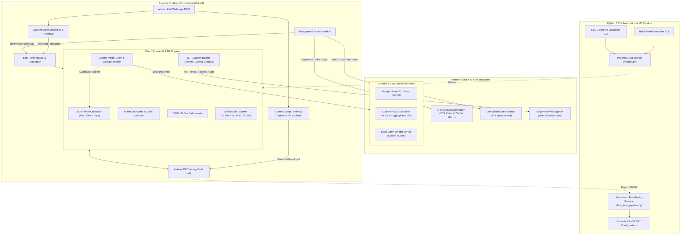

<div align="center">
  <h1>Cogwheel SEO & GEO Studio</h1>
  <p><strong>Enterprise Hospitality Search & Generative Engine Optimization (GEO) Suite</strong></p>
  <p>
    <a href="https://github.com/jisan-razibmarketing/Cogwheel-SEO-Templates/actions"></a>
    
    
    
    
    <a href="https://github.com/jisan-razibmarketing/Cogwheel-SEO-Templates/graphs/contributors"></a>
    
  </p>
</div>

---

## Overview

**Cogwheel SEO & GEO Studio** is a production-grade Chrome Side Panel inspector, template engine, and batch auditing pipeline built specifically for multi-property hospitality portfolios (**Marriott International, Hilton Worldwide, IHG Hotels & Resorts, Hyatt Hotels Corporation, and Independent Luxury Hotels**).

The suite combines real-time physical pixel budgeting (Arial 20px / 14px), automated franchise brand guardrail enforcement, Generative Engine Optimization (GEO) scoring for AI citation readiness (Google Gemini, ChatGPT Search, Perplexity), composable Schema.org structured data generators, and client-ready deliverable exports.

---

## System Architecture

<div align="center">
  
</div>

<details open>
<summary><strong>System Topology Flowchart (Mermaid)</strong></summary>



</details>

For complete technical specifications, review the [Architecture Guide](docs/ARCHITECTURE.md).

---

## Enterprise Feature Matrix

| Capability | Module | Scope & Technical Implementation | Primary Business Benefit |
|---|---|---|---|
| **Real-Time SERP Pixel Engine** | `pixelCalculator.ts` | Arial 20px (580px Title ceiling) and Arial 14px (920px Meta Description ceiling) exact glyph width table. | Prevents Google search snippet truncation on desktop and mobile. |
| **Brand Guardrails Engine** | `brandGuardrails.ts` | Case-insensitive lexical scanner checking franchise prohibited terms, superlative claims, and mandatory suffixes across Marriott, Hilton, IHG, Hyatt, and Independent portfolios. | Ensures 100% brand audit compliance with zero corporate franchise penalties. |
| **GEO AI Citation Scorer** | `cogwheelTemplates.ts` | Evaluates entity density, content depth (450+ words), structured Q&A, and `FAQPage` schema presence. | Positions hotel web pages as authoritative sources in Google Gemini Overviews and ChatGPT Search. |
| **JSON-LD Entity Graph Builder** | `auditExporters.ts` | Synthesizes Schema.org `@graph` with `Hotel`, `PostalAddress`, `GeoCoordinates`, `amenityFeature`, and `FAQPage`. | Eliminates rich snippet validation errors in Google Search Console. |
| **Client-Ready Deliverable Exports** | `ExportAuditDropdown.tsx` | Generates 3 deliverables: Executive HTML Audit Report (print-ready), Copy-Ready JSON-LD Package, and Portfolio CSV Export. | Saves 3+ hours per property in client reporting and developer handoffs. |
| **Universal Injection & SPA Support** | `content/index.ts` | Pings content script, injects dynamically via `scripting.executeScript` across all frames, patches History API with 800ms debounce, and handshakes with `SIDE_PANEL_READY`. | Seamlessly audits single-page applications and dynamic booking engines without page refresh friction. |
| **Options Page & Safe Guardrails** | `options/OptionsApp.tsx` | User consent toggle (off by default), allowlist/blocklist domains, auto vs manual capture, password detection blocking, "REC" badge, and per-domain data purge. | Guarantees enterprise GDPR/CCPA privacy compliance and user control over training data collection. |
| **Universal DOM Capture & Hardened Sanitizer** | `training-capture.ts` | Read-only DOM harvester preserving legitimate emails and URL queries while strictly redacting phone numbers, JWTs, API tokens, credit cards, and IBANs into typed `CapturedWebSample` (v3.0). | Zero data-leakage harvesting of real-world hotel pages for AI fine-tuning. |
| **IndexedDB AI Training Vault v3** | `training-vault.ts` | Client-side database (`CogwheelTrainingVaultDB` v3) with `contentHash` versioning, automated `pageType` classification, extraction confidence scoring, and automated schema migration. | Build proprietary hospitality SEO training sets with full version history and deduplication. |
| **SFT Dataset Builder & API Sync** | `dataset-builder.ts` | Formats training pairs into Google Gemini SFT (.jsonl), ChatML OpenAI/Unsloth (.jsonl), and Alpaca formats, with direct Web App API sync. | Eliminates manual data preparation for model fine-tuning runs. |
| **Custom Model Inference & Fallback Router** | `custom-model-client.ts` | Multi-provider client (Tuned Gemini, Custom REST, Ollama/vLLM) with zero-latency failover to deterministic local rules. | Deploy custom-trained hospitality models with 100% guaranteed uptime and reliability. |
| **Python SFT & LoRA Pipeline** | `fine_tune_pipeline.py` | Pydantic validation, deterministic 90/10 train-val split, auto-generation of Unsloth/LoRA scripts and Vertex AI configs, and SERP benchmarking. | Enables repeatable, enterprise-grade LLM fine-tuning across hotel portfolios. |
| **Two-Layer Free Auto-Updater** | `auto-updater.ts` | Background Manifest V3 service worker executing Layer A silent OTA data sync and Layer B SemVer binary update alerts. | Zero-maintenance client extension without requiring Chrome Web Store republishing. |
| **Python Batch Portfolio CLI** | `scripts/python/` | CLI taking URLs or CSV input, evaluating On-Page, Schema, and GEO readiness, and outputting executive CSV reports. | Enables agency-wide batch auditing across 50+ hotel properties in minutes. |

---

## Master Hospitality SEO & GEO Templates

The repository includes production-ready Markdown templates in [`templates/`](templates/) engineered with YAML frontmatter and consistent template variables:

### 1. [`brand-compliant-hotel-onpage.md`](templates/brand-compliant-hotel-onpage.md)
- **Scope**: On-page copy architecture complying with strict character caps and restricted terminology across Marriott Bonvoy, Hilton Honors, IHG One Rewards, World of Hyatt, and Independent brands.
- **Key Features**: 580px title formulas, 920px meta descriptions, single primary H1 hierarchy, and brand-specific forbidden terminology tables.

### 2. [`hotel-geo-ai-visibility.md`](templates/hotel-geo-ai-visibility.md)
- **Scope**: Generative Engine Optimization (GEO) guide designed to maximize citation frequency in Google Gemini, ChatGPT Search, and Perplexity Pro.
- **Key Features**: Conversational traveler prompt testing, high-density entity positioning, and machine-readable structured Q&A blocks.

### 3. [`hotel-gbp-unap-audit.md`](templates/hotel-gbp-unap-audit.md)
- **Scope**: Universal Name, Address, and Phone (UNAP) citation auditing across Google Business Profile, Apple Maps, TripAdvisor, Bing Places, and OTAs.
- **Key Features**: 30-day GBP content cadence, review response frameworks for positive/negative guest reviews, and local citation audit checklists.

### 4. [`hotel-lodging-schema.md`](templates/hotel-lodging-schema.md)
- **Scope**: Complete, copy-pasteable JSON-LD `@graph` schema package for hotel property landing pages.
- **Key Features**: Unified Schema.org structured data combining `Hotel`, `PostalAddress`, `GeoCoordinates`, `amenityFeature`, `FAQPage`, and `sameAs` entity links.

### 5. [`direct-booking-ota-displacement.md`](templates/direct-booking-ota-displacement.md)
- **Scope**: Commercial conversion strategy shifting travelers from high-commission OTAs (Expedia, Booking.com) to direct booking channels.
- **Key Features**: Pre-booking window communication, transparent fee schedules, loyalty points value comparison tables, and direct booking guarantee CTAs.

---

## 78-Keyword Strategy Matrix

The repository includes a comprehensive 78-keyword hospitality strategy matrix at [data/78-keyword-strategy-matrix.json](data/78-keyword-strategy-matrix.json) categorized across:
1. **Brand & Direct Booking (13 keywords)**: Capturing high-intent branded reservations and OTA displacement.
2. **Local & Neighborhood (13 keywords)**: Hyper-local downtown, beachfront, and district queries.
3. **Airport & Transit (13 keywords)**: Airport shuttles, layover accommodations, and transit hubs.
4. **Meetings & Weddings (13 keywords)**: Corporate banquet rooms, wedding venues, and RFP captures.
5. **Extended Stay & Corporate (13 keywords)**: Kitchen suites, weekly rates, and business traveler packages.
6. **Conversational AI Prompts (13 keywords)**: Voice assistant and generative AI prompt discovery.

---

## Chrome Extension Setup

### Installation (Developer Mode)
1. Clone the repository:
   ```bash
   git clone https://github.com/jisan-razibmarketing/Cogwheel-SEO-Templates.git
   cd Cogwheel-SEO-Templates
   ```
2. Build the production extension bundle:
   ```bash
   cd chrome-extension
   npm ci
   npm run build
   ```
3. Open Google Chrome and navigate to `chrome://extensions/`.
4. Toggle **Developer mode** in the top-right corner.
5. Click **Load unpacked** and select the `chrome-extension/dist` folder.
6. Open any hotel website or property URL and click the Cogwheel extension icon to launch the Side Panel.

### In-App Workflows
- **Live SERP & Social Preview**: Toggle between Desktop SERP (580px limit), Mobile SERP (narrower thresholds with favicon), and Social Open Graph card previews.
- **Instant Code Remediation**: Click **Fix ->** on any flagged audit issue to view an inline code diff preview with a 1-click **Copy Patch** button.
- **AI Training Data Harvesting & Vault**: Click **Capture for AI Training** in Template Studio to capture PII-sanitized DOM pairs, evaluate quality scores (0-100), and curate fine-tuning datasets in the **Dataset** tab.
- **Multi-Format Dataset Export & API Sync**: Export curated pairs to Google Gemini SFT (.jsonl), ChatML/Unsloth (.jsonl), or Alpaca formats, or sync directly to the Cogwheel Web App API via Bearer token authentication.
- **Custom Model Inference & Fallback**: Configure custom fine-tuned model endpoints (Tuned Gemini, Custom REST, Ollama/vLLM) in **Settings** with automated fallback to Cogwheel's deterministic rules engine.
- **Export Audit Deliverables**: Click **Export** in the top header to generate client-ready Executive HTML reports, copy-ready JSON-LD snippets, or portfolio CSV rows.

---

## Local Development & Python Automation

### Full-Stack Build & Test Verification
```bash
# 1. Typecheck TypeScript across root and extension
npm run typecheck
cd chrome-extension && npx tsc --noEmit && cd ..

# 2. Run Vitest test suite (122 tests passing across 28 suites)
npm test

# 3. Build Next.js production web application
npm run build

# 4. Run Python master test suite & schema validation
python3 tests/python/run_tests.py
python3 scripts/python/validate_schemas.py
```

### Python Batch Portfolio Auditing CLI
```bash
# Run batch audit across hotel property URLs
python3 scripts/python/batch_portfolio_audit.py \
  --urls "https://www.marriott.com/hotel-a" "https://www.hilton.com/hotel-b" \
  --output-csv portfolio_audit_results.csv
```

### Python Supervised Fine-Tuning (SFT) & LoRA Pipeline
```bash
# Validate SFT dataset, generate 90/10 split, and create Unsloth / LoRA training scripts
python3 scripts/python/fine_tune_pipeline.py \
  --dataset dataset.jsonl \
  --format chatml \
  --output-dir ./fine_tune_output \
  --generate-scripts \
  --benchmark
```

### Website Image Optimization Audit Tool (CLI & Web UI)
Audits any website for image performance, SEO alt tags, Core Web Vitals, WebP/AVIF adoption, and layout shifts. Generates a multi-tab Excel spreadsheet matching the [reference Google Sheet layout](https://docs.google.com/spreadsheets/d/1gdX3whxcXFlVNJDat2Avz_q3haNRfWz39TAMK0Q6QGc/edit?gid=1623068993#gid=1623068993).

```bash
# Run standalone zero-dependency Python CLI auditor
python3 outputs/site_image_audit.py https://example.com --max-pages 50 --size-threshold 100 --output image-audit.xlsx

# Audits include:
# 1. Image Optimization  — Matches reference sheet layout with =IMAGE(B2) and =LEN(...) formulas
# 2. Overview            — Executive scorecard with crawled pages, failure counts & format breakdown
# 3. Image Inventory     — Comprehensive technical audit (HTML dimensions, loading behavior, status)
# 4. Recommendations     — Prioritized guidance for WebP/AVIF, Core Web Vitals (LCP/CLS), and WCAG
# 5. Crawl Log           — Page-by-page crawl status, response time, and discovered asset count
```

**Web Interface & API:**
- In the dashboard, click **Audit Images** in the **Site Crawl** tab or launch from **Enterprise SEO Labs**.
- Live crawl telemetry displays pages scanned, images found, oversized assets, and missing alt counts.
- 1-click download as `.xlsx` or export directly to native Google Sheets when service account credentials (`GOOGLE_SERVICE_ACCOUNT_B64` or `GOOGLE_SERVICE_ACCOUNT_JSON`) are configured.
- *Accessibility note:* Correctly distinguishes informative images from decorative images (`alt=""`), which are valid under WCAG and not treated as defects.

**Google Sheets Configuration & Setup:**
- To enable direct export to native Google Sheets, provide a Google Service Account in your environment:
  ```bash
  export GOOGLE_SERVICE_ACCOUNT_JSON='{"type": "service_account", ...}'
  # OR Base64 encoded:
  export GOOGLE_SERVICE_ACCOUNT_B64="<base64_json_string>"
  # Optional Google Drive Parent Folder ID:
  export GOOGLE_DRIVE_ROOT_FOLDER_ID="<folder_id>"
  ```
- If credentials are not present, the tool automatically provides the downloadable `.xlsx` workbook with all 5 tabs and formulas.
- Reports are created privately in the configured service account's drive and are never made public.

**Crawl Coverage & Known Limitations:**
- **Page Limits:** Default 50 pages, configurable from 1 to 200 via `--max-pages` (or UI slider). Polite 100ms–150ms delays prevent rate-limiting.
- **Discovery Sources:** Scans standard `` & ``, lazy attributes (`data-src`, `data-lazy-src`, `data-original`), `<picture>/<source>`, CSS background images, XML sitemaps, and WordPress REST Media APIs.
- **Known Limitations:**
  - Pages hidden behind logins, paywalls, or CAPTCHA challenges are not bypassed and are recorded as skipped in the Crawl Log.
  - Pure client-rendered SPA frameworks (without SSR/prerendering) may yield partial DOM assets unless static markup is available.
  - Image preview formulas (`=IMAGE(B2)`) require image URLs to be publicly reachable by Google Sheets servers. Cloudflare or hotlink-protected assets will display their clickable URLs in Column B even if Google Sheets cannot proxy the thumbnail into Column A.

### Heading Structure Optimization Audit Tool (The Nines Reference Parity)
Audits hotel and enterprise websites for rendered heading hierarchy (H1–H6), detects inverted ordering (e.g. booking widget `<h3>` preceding main `<h1>`), unrendered JavaScript template literals (`<h2>'+page.title+'</h2>`), missing/multiple H1s, and skipped levels. Generates a multi-tab workbook with the exact 6-column layout from the reference template [Heading Structure Optimization- thenines](https://docs.google.com/spreadsheets/d/1W_kydZFwQPl3qQ4Aybrh9JvQ1dXPG2-M/edit?pli=1&gid=400022639#gid=400022639).

```bash
# Run standalone zero-dependency Python CLI auditor for The Nines (or any site)
python3 outputs/site_heading_audit.py https://thenines.com/ --max-pages 60

# Features:
# 1. Heading Optimization — Matches reference sheet with Category Banners (#4A86E8), Yellow Headers (#FFE599), and Green Recommendations (#B6D7A8)
#    Exact 6 Columns: Page URL | Keyword | Old Headline | Old Heading Level | New Headline (optimized) | New Heading Level
# 2. Audit Summary       — Coverage boundary statement, total headings, H1–H6 counts, and hierarchy issues flagged
# 3. Hierarchy Analysis  — Full technical tabular breakdown of every heading element and flagged SEO defects
# 4. Built-in Resilience — Auto-checkpointing (.heading_checkpoint_<host>.json) with --resume capability
```

**Web Interface & API:**
- Access via **Audit Headings** in the **Site Crawl** tab, task runner matrix (`heading-structure`), or **Enterprise SEO Labs**.
- Live telemetry displays pages audited, H1–H6 breakdown, missing H1s, multi-H1s, skipped levels, and unrendered template variables.
- Direct export to Excel `.xlsx` or native Google Sheets via Google Drive/Sheets API.


---

## Repository Governance

- [Security Policy](SECURITY.md): Vulnerability reporting procedures and response timeline.
- [Changelog](CHANGELOG.md): Detailed release notes adhering to Keep a Changelog standards.
- [Architecture Specifications](docs/ARCHITECTURE.md): Multi-tier architecture, engines, and CSP governance.
- [Issue Template](.github/ISSUE_TEMPLATE/bug_report.md): Structured bug report intake template.

---

## Contributors

Thanks to all contributors who have helped build, optimize, and maintain Cogwheel SEO & GEO Studio!

### Lead Maintainer & Architect
<table>
  <tr>
    <td align="center">
      <a href="https://github.com/jisan-razibmarketing">
        <br />
        <sub><b>Shah Jisan (SJ)</b></sub>
      </a><br />
      <sub>Lead Architect & Maintainer</sub><br />
      <a href="https://github.com/jisan-razibmarketing/Cogwheel-SEO-Templates/commits?author=jisan-razibmarketing" title="Code & Architecture">💻 🎨 🚀 📖 🛡️</a>
    </td>
  </tr>
</table>

### Automated Contributor Pipeline
This repository automatically tracks all contributions dynamically via the GitHub Graph:

<a href="https://github.com/jisan-razibmarketing/Cogwheel-SEO-Templates/graphs/contributors">
  
</a>

Contributions of all types—code, SEO templates, hotel guardrail rules, schema specs, and documentation—are warmly welcomed.

---

## License

Distributed under the [MIT License](LICENSE).
Copyright (c) 2026 Cogwheel Marketing & SEO Contributors.
