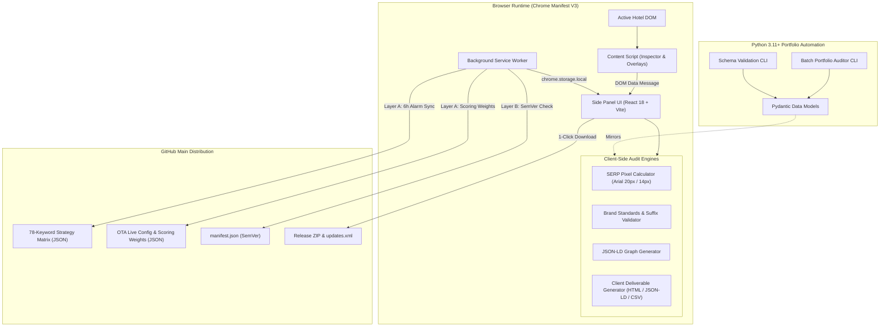

<div align="center">
  <h1>Cogwheel SEO & GEO Studio</h1>
  <p><strong>Enterprise Hospitality Search & Generative Engine Optimization (GEO) Suite</strong></p>
  <p>
    <a href="https://github.com/jisan-razibmarketing/Cogwheel-SEO-Templates/actions"></a>
    
    
    
    
    
  </p>
</div>

---

## Overview

**Cogwheel SEO & GEO Studio** is a production-grade Chrome Side Panel inspector, template engine, and batch auditing pipeline built specifically for multi-property hospitality portfolios (**Marriott International, Hilton Worldwide, IHG Hotels & Resorts, Hyatt Hotels Corporation, and Independent Luxury Hotels**).

The suite combines real-time physical pixel budgeting (Arial 20px / 14px), automated franchise brand guardrail enforcement, Generative Engine Optimization (GEO) scoring for AI citation readiness (Google Gemini, ChatGPT Search, Perplexity), composable Schema.org structured data generators, and client-ready deliverable exports.

---

## System Architecture



For complete technical specifications, review the [Architecture Guide](docs/ARCHITECTURE.md).

---

## Enterprise Feature Matrix

| Capability | Module | Scope & Technical Implementation | Primary Business Benefit |
|---|---|---|---|
| **Real-Time SERP Pixel Engine** | `pixelCalculator.ts` | Arial 20px (580px Title ceiling) and Arial 14px (920px Meta Description ceiling) exact glyph width table. | Prevents Google search snippet truncation on desktop and mobile. |
| **Brand Guardrails Engine** | `brandGuardrails.ts` | Case-insensitive lexical scanner checking franchise prohibited terms, superlative claims, and mandatory suffixes across Marriott, Hilton, IHG, Hyatt, and Independent portfolios. | Ensures 100% brand audit compliance with zero corporate franchise penalties. |
| **GEO AI Citation Scorer** | `cogwheelTemplates.ts` | Evaluates entity density, content depth (450+ words), structured Q&A, and `FAQPage` schema presence. | Positions hotel web pages as authoritative sources in Google Gemini Overviews and ChatGPT Search. |
| **JSON-LD Entity Graph Builder** | `auditExporters.ts` | Synthesizes Schema.org `@graph` with `Hotel`, `PostalAddress`, `GeoCoordinates`, `amenityFeature`, and `FAQPage`. | Eliminates rich snippet validation errors in Google Search Console. |
| **Client-Ready Deliverable Exports** | `ExportAuditDropdown.tsx` | Generates 3 deliverables: Executive HTML Audit Report (print-ready), Copy-Ready JSON-LD Package, and Portfolio CSV Export. | Saves 3+ hours per property in client reporting and developer handoffs. |
| **Two-Layer Free Auto-Updater** | `auto-updater.ts` | Background Manifest V3 service worker executing Layer A silent OTA data sync and Layer B SemVer binary update alerts. | Zero-maintenance client extension without requiring Chrome Web Store republishing. |
| **Python Batch Portfolio CLI** | `scripts/python/` | CLI taking URLs or CSV input, evaluating On-Page, Schema, and GEO readiness, and outputting executive CSV reports. | Enables agency-wide batch auditing across 50+ hotel properties in minutes. |

---

## Master Hospitality SEO & GEO Templates

The repository includes production-ready Markdown templates in [`templates/`](templates/) engineered with YAML frontmatter and consistent template variables:

### 1. [`brand-compliant-hotel-onpage.md`](templates/brand-compliant-hotel-onpage.md)
- **Scope**: On-page copy architecture complying with strict character caps and restricted terminology across Marriott Bonvoy, Hilton Honors, IHG One Rewards, World of Hyatt, and Independent brands.
- **Key Features**: 580px title formulas, 920px meta descriptions, single primary H1 hierarchy, and brand-specific forbidden terminology tables.

### 2. [`hotel-geo-ai-visibility.md`](templates/hotel-geo-ai-visibility.md)
- **Scope**: Generative Engine Optimization (GEO) guide designed to maximize citation frequency in Google Gemini, ChatGPT Search, and Perplexity Pro.
- **Key Features**: Conversational traveler prompt testing, high-density entity positioning, and machine-readable structured Q&A blocks.

### 3. [`hotel-gbp-unap-audit.md`](templates/hotel-gbp-unap-audit.md)
- **Scope**: Universal Name, Address, and Phone (UNAP) citation auditing across Google Business Profile, Apple Maps, TripAdvisor, Bing Places, and OTAs.
- **Key Features**: 30-day GBP content cadence, review response frameworks for positive/negative guest reviews, and local citation audit checklists.

### 4. [`hotel-lodging-schema.md`](templates/hotel-lodging-schema.md)
- **Scope**: Complete, copy-pasteable JSON-LD `@graph` schema package for hotel property landing pages.
- **Key Features**: Unified Schema.org structured data combining `Hotel`, `PostalAddress`, `GeoCoordinates`, `amenityFeature`, `FAQPage`, and `sameAs` entity links.

### 5. [`direct-booking-ota-displacement.md`](templates/direct-booking-ota-displacement.md)
- **Scope**: Commercial conversion strategy shifting travelers from high-commission OTAs (Expedia, Booking.com) to direct booking channels.
- **Key Features**: Pre-booking window communication, transparent fee schedules, loyalty points value comparison tables, and direct booking guarantee CTAs.

---

## 78-Keyword Strategy Matrix

The repository includes a comprehensive 78-keyword hospitality strategy matrix at [data/78-keyword-strategy-matrix.json](data/78-keyword-strategy-matrix.json) categorized across:
1. **Brand & Direct Booking (13 keywords)**: Capturing high-intent branded reservations and OTA displacement.
2. **Local & Neighborhood (13 keywords)**: Hyper-local downtown, beachfront, and district queries.
3. **Airport & Transit (13 keywords)**: Airport shuttles, layover accommodations, and transit hubs.
4. **Meetings & Weddings (13 keywords)**: Corporate banquet rooms, wedding venues, and RFP captures.
5. **Extended Stay & Corporate (13 keywords)**: Kitchen suites, weekly rates, and business traveler packages.
6. **Conversational AI Prompts (13 keywords)**: Voice assistant and generative AI prompt discovery.

---

## Chrome Extension Setup

### Installation (Developer Mode)
1. Clone the repository:
   ```bash
   git clone https://github.com/jisan-razibmarketing/Cogwheel-SEO-Templates.git
   cd Cogwheel-SEO-Templates
   ```
2. Build the production extension bundle:
   ```bash
   cd chrome-extension
   npm ci
   npm run build
   ```
3. Open Google Chrome and navigate to `chrome://extensions/`.
4. Toggle **Developer mode** in the top-right corner.
5. Click **Load unpacked** and select the `chrome-extension/dist` folder.
6. Open any hotel website or property URL and click the Cogwheel extension icon to launch the Side Panel.

### In-App Workflows
- **Live SERP & Social Preview**: Toggle between Desktop SERP (580px limit), Mobile SERP (narrower thresholds with favicon), and Social Open Graph card previews.
- **Instant Code Remediation**: Click **Fix ->** on any flagged audit issue to view an inline code diff preview with a 1-click **Copy Patch** button.
- **Export Audit Deliverables**: Click **Export** in the top header to generate client-ready Executive HTML reports, copy-ready JSON-LD snippets, or portfolio CSV rows.

---

## Local Development & Python Automation

### Full-Stack Build & Test Verification
```bash
# 1. Typecheck TypeScript across root and extension
npm run typecheck
cd chrome-extension && npx tsc --noEmit && cd ..

# 2. Run Vitest test suite (108 tests passing across 26 suites)
npm test

# 3. Build Next.js production web application
npm run build

# 4. Run Python master test suite & schema validation
python3 tests/python/run_tests.py
python3 scripts/python/validate_schemas.py
```

### Python Batch Portfolio Auditing CLI
```bash
# Run batch audit across hotel property URLs
python3 scripts/python/batch_portfolio_audit.py \
  --urls "https://www.marriott.com/hotel-a" "https://www.hilton.com/hotel-b" \
  --output-csv portfolio_audit_results.csv
```

---

## Repository Governance

- [Security Policy](SECURITY.md): Vulnerability reporting procedures and response timeline.
- [Changelog](CHANGELOG.md): Detailed release notes adhering to Keep a Changelog standards.
- [Architecture Specifications](docs/ARCHITECTURE.md): Multi-tier architecture, engines, and CSP governance.
- [Issue Template](.github/ISSUE_TEMPLATE/bug_report.md): Structured bug report intake template.

---

## License

Distributed under the [MIT License](LICENSE).
Copyright (c) 2026 Cogwheel Marketing & SEO Contributors.
