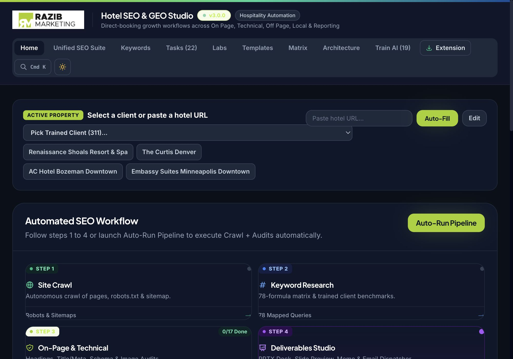
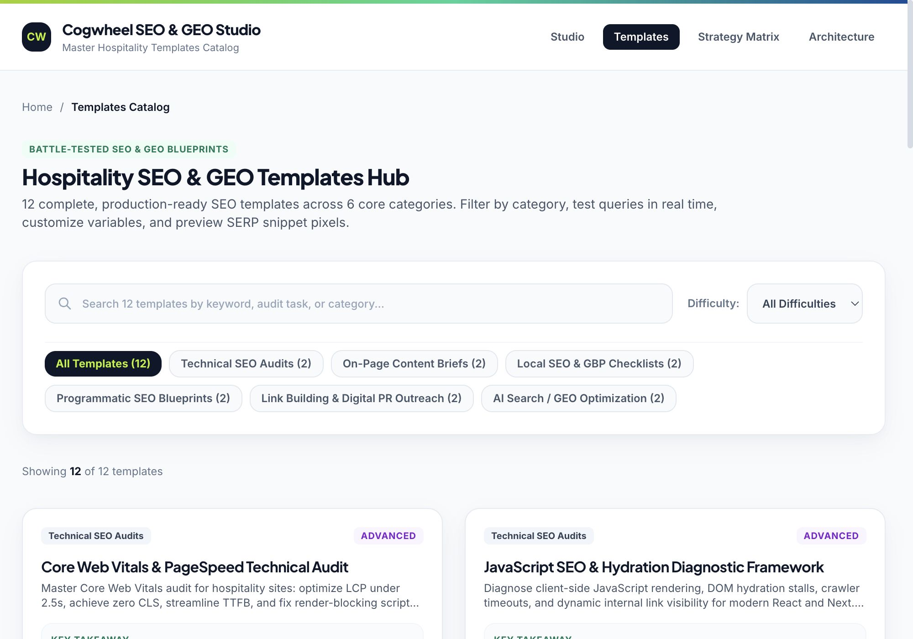
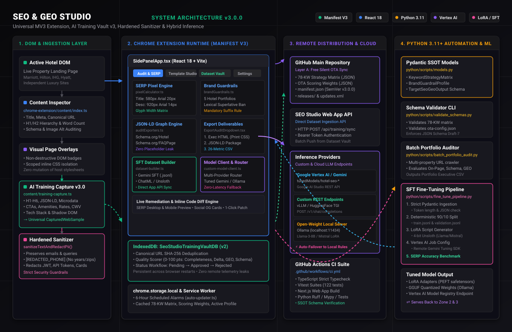

<div align="center">


# SEO & GEO Studio

**Hospitality SEO auditing, Generative Engine Optimization readiness, and client-ready reporting — in one workspace.**

[](https://github.com/nurunnobejisan/SEO-Studio/actions/workflows/ci.yml)
[](https://seo-studio-one.vercel.app)
[](LICENSE)
[](CHANGELOG.md)
[](https://nextjs.org)
[](https://www.typescriptlang.org)
[](https://www.python.org)
[](chrome-extension/)

[Live application](https://seo-studio-one.vercel.app) ·
[Download extension](https://seo-studio-one.vercel.app/cogwheel-seo-studio.zip) ·
[Documentation](docs/README.md) ·
[Changelog](CHANGELOG.md)

</div>

---

## Overview

SEO Studio is a production-oriented SEO platform for hospitality portfolios. It combines a Next.js operator workspace, a Manifest V3 Chrome extension, a measured audit engine, and a Python analysis layer.

The core rule is simple: **measure, label, or leave blank.** Rankings, search volumes, AI citations, and competitor positions are never invented. When a data source is not connected, the product says so instead of showing a plausible-looking number.

| Studio workspace | Template library |
| --- | --- |
|  |  |

## What it does

### Audit and diagnose

- Crawl a property, parse the rendered page, and produce an 11-dimension audit: technical health, crawlability, on-page SEO, headings, images, Search Console, keywords, schema, GEO readiness, algorithm impact, and a prioritized action plan.
- Parse real JSON-LD, canonical tags, heading hierarchy, metadata, and body content from the live page.
- Track provenance per report section: **measured**, **estimated**, or **unavailable**.

### Improve Generative Engine Optimization

- On-page GEO readiness derived from structured data, answer coverage, entity signals, and content depth.
- Schema-family checks for Hotel/LodgingBusiness, Restaurant, Spa, FAQPage, Organization, WebSite, and BreadcrumbList.
- VisibilitySuite import/export for teams that have a licensed AI-visibility provider. Without one, citation metrics stay explicitly unmeasured.

### Produce client deliverables

- Export the exact audit the operator is viewing as **HTML, PDF, CSV, or PPTX**.
- Generate executive memos, pitch decks, slide previews, and email drafts from supplied data only.
- No fabricated rankings, fees, revenue estimates, or citation scores in client templates.

### Operate and integrate

- Operator console with signed sessions, approval queues, and a fail-closed platform API.
- CMS connectors and reviewable self-healing patch plans for WordPress, Shopify, Webflow, and HTML.
- Chrome side panel for live page inspection, audit overlays, training capture, and OTA rule updates.
- Optional Supabase-backed durable storage; local-first by default.

### Quality and security

- DNS-aware SSRF protection with redirect re-validation.
- Per-instance rate limits, CSRF origin checks, and security headers.
- Signed `cw_session` cookies; platform APIs return `401` without a valid session.
- Synthetic data is gated behind `ALLOW_SIMULATED_DATA` and **off by default**.
- CI runs typecheck, lint, Vitest, SEO gates, integration tests, pytest, and a production build.

## Architecture



```text
Browser (Chrome MV3)                 Next.js operator workspace
┌──────────────────────┐             ┌──────────────────────────────┐
│ Side panel + content │  audit      │ /api/full-audit              │
│ scripts              │ ──────────► │ /api/audit-report            │
│ training vault       │             │ /api/platform/*              │
└──────────────────────┘             └──────────────┬───────────────┘
                                                    │
                         ┌──────────────────────────┼──────────────────────────┐
                         ▼                          ▼                          ▼
                  rules/ + crawler          reporting writers          CMS / healing
                  measured audit            HTML PDF CSV PPTX          patch plans
                         │
                         ▼
                  python/ + api/  ·  analyzers, generators, batch tools
```

See [`docs/ARCHITECTURE.md`](docs/ARCHITECTURE.md) for the full component and data-flow reference.

## Quick start

### Prerequisites

- **Node.js 20+**
- **Python 3.11+**
- **Chrome/Chromium** for the extension
- Optional: Supabase, Google Search Console, Anthropic, Semrush, VisibilitySuite credentials

### Run the web app

```bash
git clone https://github.com/nurunnobejisan/SEO-Studio.git
cd SEO-Studio

npm ci
cp .env.example .env.local     # fill only the providers you use
npm run dev                    # http://localhost:3000
```

The app starts without third-party credentials. Provider-backed sections declare themselves unavailable until configured.

### Run the Python tools

```bash
python3.11 -m venv .venv
source .venv/bin/activate
pip install -r requirements.txt
pytest tests/python -q
```

### Build and load the extension

```bash
npm install --prefix chrome-extension
npm run build:extension
```

Then open `chrome://extensions`, enable **Developer mode**, choose **Load unpacked**, and select `chrome-extension/dist`.

The same build also produces `public/cogwheel-seo-studio.zip` for release uploads.

### Production build

```bash
npm run build
npm start
```

## Commands

| Command | Purpose |
| --- | --- |
| `npm run dev` | Start the Next.js development server |
| `npm run build` | Production Next.js build |
| `npm run typecheck` | `tsc --noEmit` |
| `npm run lint` | ESLint via Next.js |
| `npm test` | Vitest unit and integration suites |
| `npm run lint:seo` | 10-gate SEO integrity linter |
| `npm run test:seo` | SEO engine tests |
| `npm run test:ts` | TypeScript integration tests |
| `pytest tests/python -q` | Python analyzer and generator tests |
| `npm run build:extension` | Build, verify, and package the Chrome extension |
| `npm run export:schemas` | Mirror the canonical `schemas/*.json` contracts into `shared/schemas/` for the Python engine |

## Configuration

Copy [`.env.example`](.env.example) to `.env.local` and set only what you need.

| Variable | Required | Purpose |
| --- | --- | --- |
| `PLATFORM_OPERATOR_TOKEN` | Production `/platform` | Bootstrap operator sign-in token (32+ chars) |
| `PLATFORM_SESSION_SECRET` | Production `/platform` | HMAC key for signed `cw_session` cookies (32+ chars) |
| `CMS_VAULT_KEY` | CMS vault | Encryption key for stored CMS credentials |
| `ANTHROPIC_API_KEY` | Optional | AI-assisted generation and analysis |
| `SUPABASE_URL` / `SUPABASE_SERVICE_ROLE_KEY` | Optional | Durable platform storage |
| `SEMRUSH_API_KEY` | Optional | Keyword and competitor data |
| `GOOGLE_SERVICE_ACCOUNT_B64` | Optional | Search Console, Drive, and Docs integrations |
| `ALLOW_SIMULATED_DATA` | Never in production | Enables synthetic demo data for local tests only |

Secrets belong in environment variables or the platform vault — never in the repository.

## Repository map

```text
.
├── src/
│   ├── app/                  Next.js App Router pages and API routes
│   ├── components/           Studio, audit, reporting, and platform UI
│   ├── core/                 Audit engine, reporting, security, training
│   ├── lib/                  Platform session, egress guard, rate limits
│   ├── rules/                Measured HTML audit rules
│   └── tasks/                Task modules and generators
├── platform/                 Operator console domain layer
├── ai/                       Provider routing and AI helpers
├── cms/                      CMS connectors and credential vault
├── healing/                  Reviewable self-healing patch plans
├── chrome-extension/         Manifest V3 extension source and build
├── python/                   Analyzers, generators, batch tools
├── api/                      Python HTTP bridge and Pydantic models
├── schemas/                  Zod schema sources
├── shared/schemas/           Generated JSON Schema mirror for Python (from schemas/)
├── rules/                    Standalone audit rule engine
├── tests/                    Vitest, node:test, pytest, e2e, fixtures
├── docs/                     Architecture, security, reporting, roadmap
└── scripts/                  Build, export, and release automation
```

The canonical placement rules live in [`docs/PROJECT_STRUCTURE.md`](docs/PROJECT_STRUCTURE.md).

## Documentation

| Document | Description |
| --- | --- |
| [Documentation index](docs/README.md) | Start here for the full docs map |
| [Architecture](docs/ARCHITECTURE.md) | System topology, extension, platform, and data contracts |
| [Technical specification](docs/SPEC.md) | Detailed behavior and interfaces |
| [Security](docs/SECURITY.md) | Auth, SSRF, rate limits, local bridges, data integrity |
| [Platform runtime](docs/PLATFORM_RUNTIME.md) | Operator console, durable storage, approvals |
| [Reporting](docs/REPORTING.md) | HTML/PDF/CSV/PPTX export behavior and provenance |
| [Universal mode](docs/UNIVERSAL_MODE.md) | Non-hospitality sites and CMS-agnostic audits |
| [CMS integrations](docs/CMS_INTEGRATIONS.md) | WordPress, Shopify, Webflow, and HTML adapters |
| [Self-healing pipeline](docs/SELF_HEALING_PIPELINE.md) | Patch generation, review, and application |
| [AI SEO brain](docs/AI_SEO_BRAIN.md) | Agents, tools, and routing |
| [SEO expert guide](docs/SEO_EXPERT_GUIDE.md) | Operator workflow |
| [Repository audit](docs/REPOSITORY_AUDIT.md) | Findings, remediation status, and known limitations |
| [Roadmap](docs/ROADMAP_UNIVERSAL_AUDIT_AND_CMS_AUTOFIX.md) | Phases and remaining work |
| [Changelog](CHANGELOG.md) | Release history |

## Deployment

- **Web app:** Vercel production at [seo-studio-one.vercel.app](https://seo-studio-one.vercel.app).
- **CI:** [`.github/workflows/ci.yml`](.github/workflows/ci.yml) runs on every push and pull request.
- **Extension releases:** [`.github/workflows/auto-release.yml`](.github/workflows/auto-release.yml) builds and attaches `cogwheel-seo-studio.zip` when the manifest version changes.
- **Updates:** `updates.xml` and the packaged ZIP are served from `public/`.

## Contributing

Contributions are welcome. Read [`CONTRIBUTING.md`](CONTRIBUTING.md) and the [`CODE_OF_CONDUCT.md`](CODE_OF_CONDUCT.md) before opening a pull request.

## Security

Do not report vulnerabilities in public issues. See [`SECURITY.md`](SECURITY.md) for the private reporting process and supported versions.

## License

[MIT](LICENSE) © Nurunnobe Jisan.
