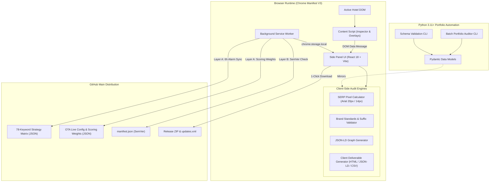

# System Architecture & Technical Specifications

This document outlines the software architecture, design patterns, data contracts, and execution pipelines of **Cogwheel SEO & GEO Studio**.

---

## 1. Architectural Overview & Design Principles

Cogwheel SEO & GEO Studio is engineered as a hybrid web application and client-side browser side panel suite specifically tailored for multi-property hospitality portfolios (Marriott International, Hilton Worldwide, IHG Hotels & Resorts, Hyatt Hotels Corporation, and Independent Luxury Hotels).

### Core Architectural Tenets
- **Local-First & Offline Resilience**: Page inspection, pixel calculation, brand guardrail validation, and structured data generation run client-side without dependency on external third-party crawlers.
- **Single Source of Truth (SSOT)**: A single canonical schema definition authored in TypeScript Zod (`src/schemas/`) compiles into standard JSON Schema Draft-7 files (`schemas/`) and Python 3.11+ Pydantic models (`scripts/python/models.py`), ensuring bidirectional contract consistency.
- **Strict Deterministic Pixel Budgeting**: Character-width lookup tables based on Google SERP Arial typography replace rough character count heuristics with exact physical pixel measurements.
- **Two-Layer Free Over-the-Air (OTA) Updates**: Decouples lightweight rule and keyword matrix updates (synced silently in the background) from binary extension updates (notified via badge and 1-click package download).

---

## 2. Multi-Tier System Topology



---

## 3. Chrome Extension Architecture (Manifest V3)

The extension is structured under modern Chrome Manifest V3 specifications:

### 3.1 Content Script (`chrome-extension/src/content/index.ts`)
- **Inspection Engine**: Extracts page title, meta description, canonical URL, heading hierarchy (`h1`, `h2`, `h3`), image dimensions and alt attributes, word counts, and existing JSON-LD `<script>` elements.
- **Visual Overlays**: Highlights heading structures and image accessibility directly over the inspected page DOM without altering host styles.
- **Execution Boundary**: Injected on-demand via `chrome.scripting.executeScript` when the user opens the side panel or clicks Refresh, avoiding persistent CPU overhead on background tabs.

### 3.2 Side Panel Application (`chrome-extension/src/sidepanel/SidePanelApp.tsx`)
- **Framework**: React 18, TypeScript 5.5, Tailwind CSS, Lucide icons.
- **State Management**: Reactive state tracking `pageData`, `scores`, `activeProfile`, and live editable overrides.
- **Design Aesthetic**: Linear- and Vercel-inspired dark theme (`#09090B` canvas, `#111113` surface, `#27272A` borders, `tabular-nums` typography).

### 3.3 Background Service Worker (`chrome-extension/src/background/auto-updater.ts`)
- **Lifecycle Events**: Listens to `chrome.runtime.onInstalled`, `chrome.runtime.onStartup`, and `chrome.alarms` triggers.
- **Alarm Cadence**: Executes `cogwheel_auto_update_check` every 360 minutes (6 hours).

---

## 4. Two-Layer Free Auto-Update System


---

## 5. Core Audit & Calculation Engines

### 5.1 Real-Time SERP Pixel Calculator (`pixelCalculator.ts`)
Standard character counting fails to reflect actual Google SERP truncation because variable-width fonts (Arial 20px for titles, Arial 14px for descriptions) allocate vastly different horizontal space per glyph:
- Narrow characters (`i`, `l`, `|`, `.`, `,`): `4px`
- Medium characters (`a`, `e`, `o`, digits): `9px - 10px`
- Wide characters (`W`, `M`, `m`, em-dash `—`): `13px - 17px`

The engine evaluates titles against the `580px` desktop limit and descriptions against the `920px` snippet limit.

### 5.2 Brand Guardrails Engine (`brandGuardrails.ts`)
Enforces franchise standards across 5 major hospitality classifications:
- **Marriott**: Enforces max 60-character titles, prohibited terms (`free breakfast`, `marriott rewards`, `bonvoy rewards`, `best hotel`, `cheapest rate`), and the mandatory suffix `Marriott Bonvoy`.
- **Hilton**: Enforces max 60-character titles, prohibited terms (`free wifi`, `hilton hhonors`, `best rates in town`, `free cancellation`), and the mandatory suffix `Hilton Honors`.
- **IHG**: Enforces max 60-character titles, prohibited terms (`ihg rewards club`, `best hotel`, `free breakfast`), and the mandatory suffix `IHG One Rewards`.
- **Hyatt**: Enforces max 60-character titles, prohibited terms (`gold passport`, `cheapest rooms`, `free cancellation`), and the mandatory suffix `World of Hyatt`.
- **Independent**: Enforces max 65-character titles, prohibited terms (`cheapest hotel in`, `100% satisfaction guaranteed`), and the mandatory suffix `Official Site`.

### 5.3 Multi-Format Deliverable Exporter (`auditExporters.ts`)
- **Executive HTML Audit Report**: Self-contained HTML with print CSS, KPI scorecards, SERP previews, and remediation tables.
- **Copy-Ready JSON-LD Package**: Synthesizes verified `Schema.org/Hotel` and `Schema.org/FAQPage` structured data with zero placeholder leaks.
- **Portfolio CSV Export**: RFC 4180-compliant tabular export across 26 metrics for portfolio-level visibility decks.

---

## 6. Single Source of Truth (SSOT) Data Architecture

Data models and schemas are synchronized across TypeScript and Python:

```
src/schemas/validation.ts (TypeScript Zod Canonical Source)
  │
  ├──> scripts/export-json-schemas.ts
  │      └──> schemas/*.schema.json (JSON Schema Draft-7)
  │
  └──> scripts/python/models.py (Python 3.11+ Pydantic Models)
         ├──> scripts/python/validate_schemas.py
         └──> scripts/python/batch_portfolio_audit.py
```

---

## 7. Security, Sandboxing & CSP Governance

- **Content Security Policy (CSP)**: Extension operates under Manifest V3 restrictions; script execution is strictly local (`'self'`), disallowing remote `eval` or unsanctioned script injections.
- **XSS Sanitization**: Attribute and HTML escaping utilities protect exported deliverables and DOM overlay viewers against script injection.
- **Network Permissions**: Restricted to `https://raw.githubusercontent.com/*` and `https://api.github.com/*` exclusively for OTA rule synchronization and SemVer checking.
- **Zero Host Mutation**: The DOM inspector performs read-only audits; non-destructive overlays are scoped with isolated inline styles and easily dismissed.
