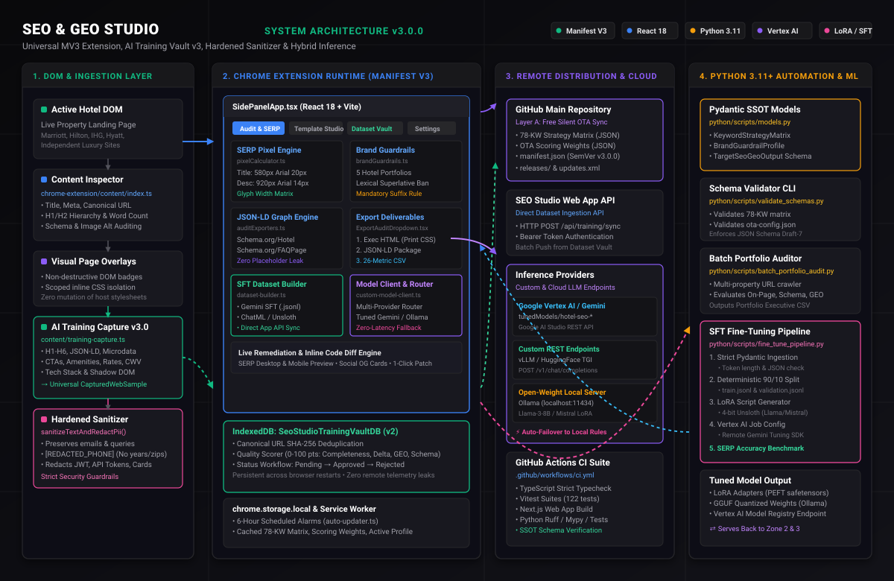
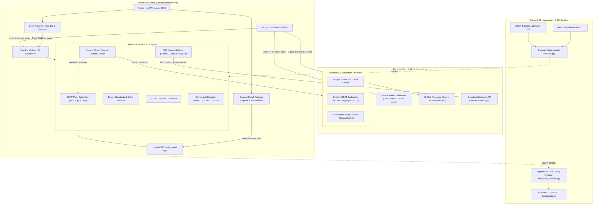
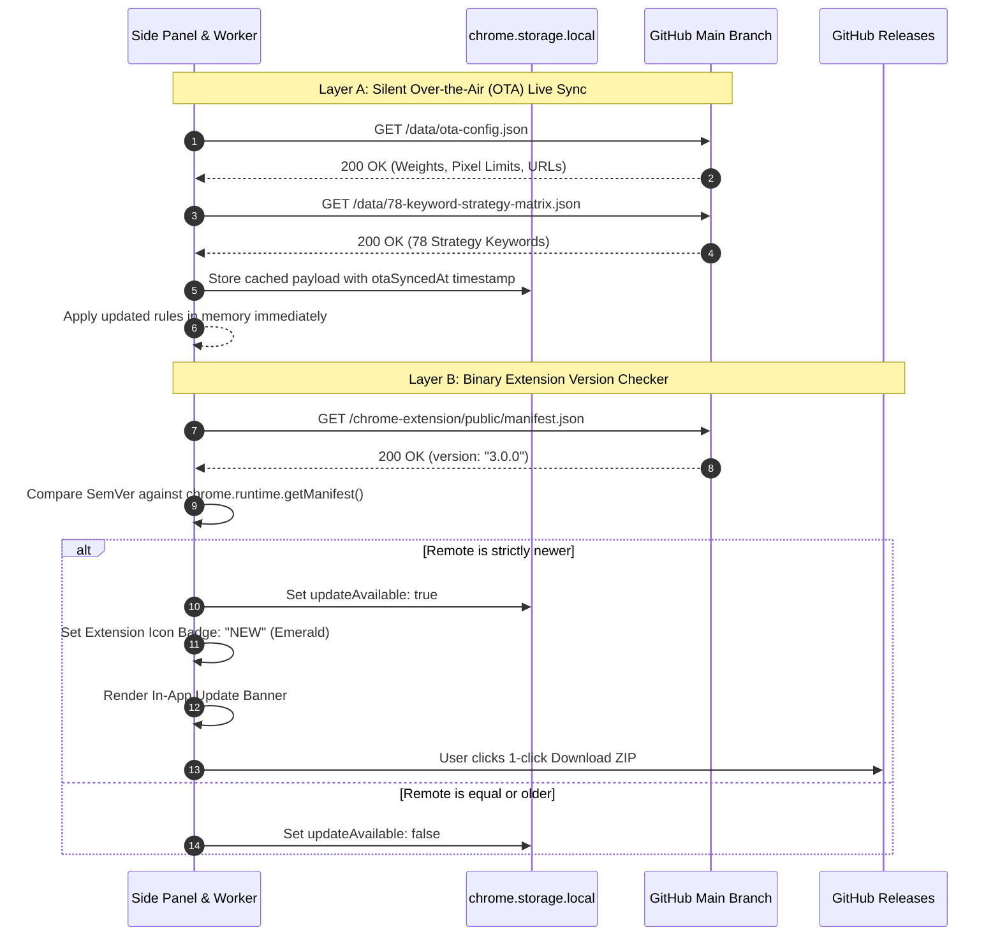
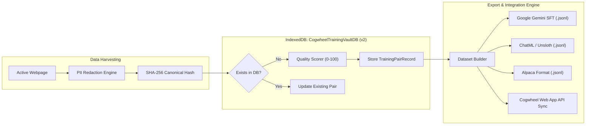
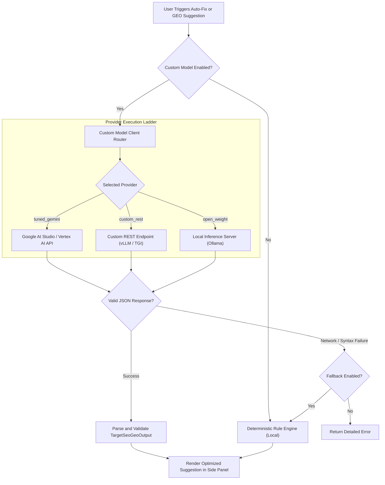
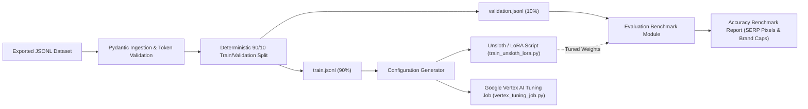

# System Architecture & Technical Specifications

> **Version**: 3.0.0  
> **Last Updated & Verified**: November 24, 2026  
> **Status**: Production — Unified Multi-Source Architecture (Claude-SEO + Open-SEO + FastMCP GSC)

This document outlines the software architecture, design patterns, data contracts, and execution pipelines of **Cogwheel SEO & GEO Studio**.

---

## 1. Architectural Overview & Design Principles

Cogwheel SEO & GEO Studio is engineered as an enterprise hybrid web application, client-side browser side panel suite, and offline machine learning pipeline tailored specifically for multi-property hospitality portfolios (**Marriott International, Hilton Worldwide, IHG Hotels & Resorts, Hyatt Hotels Corporation, and Independent Luxury Hotels**).

### Core Architectural Tenets
- **Local-First & Offline Resilience**: Page inspection, pixel calculation, brand guardrail validation, and structured data generation run client-side without dependency on external third-party crawlers.
- **Single Source of Truth (SSOT)**: A single canonical schema definition authored in TypeScript Zod (`src/schemas/`) compiles into standard JSON Schema Draft-7 files (`schemas/`) and Python 3.11+ Pydantic models (`python/scripts/models.py`), ensuring bidirectional contract consistency across web, extension, and automation layers.
- **Strict Deterministic Pixel Budgeting**: Character-width lookup tables based on Google SERP Arial typography replace rough character count heuristics with exact physical pixel measurements (580px Title ceiling, 920px Meta Description ceiling).
- **Two-Layer Free Over-the-Air (OTA) Updates**: Decouples lightweight rule and keyword matrix updates (synced silently in the background via GitHub raw endpoints) from binary extension updates (notified via badge alerts and 1-click package downloads).
- **Universal Privacy-Preserving AI Training Harvest**: Non-destructive, read-only DOM capture coupled with an automated PII redaction engine (scrubbing emails, telephone numbers, IP addresses, credit cards, and URL auth query tokens) allows continuous collection of high-quality hospitality training data directly in the browser.
- **Client-Side IndexedDB Training Vault**: Local, persistent storage (`CogwheelTrainingVaultDB`) with deterministic canonical URL hashing, quality score algorithms (0-100), and multi-format Supervised Fine-Tuning (SFT) dataset builders (Gemini JSONL, ChatML OpenAI/Unsloth, and Alpaca).
- **Hybrid Inference & Automatic Fallback Routing**: Multi-provider inference router allowing properties to connect custom fine-tuned models (Google Cloud Vertex AI, fine-tuned Gemini, Ollama, vLLM, HuggingFace TGI) with seamless zero-latency fallback to Cogwheel's local deterministic rules engine.
- **End-to-End Supervised Fine-Tuning (SFT) Pipeline**: Standalone Python pipeline (`python/scripts/fine_tune_pipeline.py`) providing dataset validation, deterministic 90/10 train-test splits, auto-generation of Unsloth/LoRA training scripts, and automated SERP/Schema accuracy benchmarking.

---

## 2. Multi-Tier System Topology

<div align="center">
  
</div>

<br />



---

## 3. Chrome Extension Architecture (Manifest V3)

The browser extension is structured under Chrome Manifest V3 specifications to provide maximum performance, battery efficiency, and zero persistent background footprint:

### 3.1 Content Script Layer (`chrome-extension/src/content/`)
- **Single Source of Truth Manifest**: `chrome-extension/public/manifest.json` is the sole SSOT specifying `<all_urls>`, `all_frames: true`, `match_about_blank: true`, and `run_at: "document_idle"`.
- **Universal Auto-Injection & SPA Route Detection (`index.ts`)**:
  - Automatically pings the content script upon tab activation (`tabs.onActivated`), page load (`tabs.onUpdated`), and browser history transitions (`webNavigation.onHistoryStateUpdated` / `onCommitted`). If unresponsive, dynamically injects `content.js` across all frames via `chrome.scripting.executeScript`.
  - Patches `history.pushState` and `history.replaceState`, listens to `popstate` / `hashchange`, and observes `document.title` and primary content container mutations with an 800ms debounce.
  - Computes a fast content fingerprint and triggers re-extraction only when URL or DOM content changes.
  - Connects to the side panel via `SIDE_PANEL_READY` handshake, preventing message drops without arbitrary timeouts.
  - Implements non-throwing `checkPageRestriction` reporting `RESTRICTED_PAGE` or `ALLOWED` status.
- **Visual Overlays**: Renders non-destructive DOM overlays highlighting heading structures and image accessibility directly over the inspected page without modifying host CSS stylesheets.
- **Universal Training Extractor v3.0 & Hardened Sanitizer (`training-capture.ts`)**:
  - Runs in read-only mode to extract full DOM snapshots: language, robots, viewport, hreflang alternates, canonical URL, full OpenGraph and Twitter card metadata.
  - Complete H1-H6 hierarchy in physical DOM order (`HeadingNode[]`).
  - Full parsed JSON-LD trees (`jsonLdFull[]`), schema types, and W3C Microdata (`microdata[]`).
  - Discovers internal/external links (`rel`, anchor text) and images (`src`, `alt`, dimensions, lazy loading).
  - Traverses open shadow roots and same-origin iframes (tagging frame samples with `frameId`).
  - Extracts hotel-specific hospitality blocks: rates, amenities, review scores, and visible booking/phone/email CTAs.
  - Samples Core Web Vitals via `PerformanceObserver` (LCP, CLS, INP) with graceful fallback.
  - Detects tech stack signatures (WordPress, Webflow, Shopify, Squarespace, Drupal, React, Next.js, Vue, Angular, GTM, GA4, Meta Pixel).
  - Main text extracted separately from CTA text without dropping headers or buttons wholesale; strictly never reads input/textarea values or password/payment fields.
  - Each extractor wrapped in isolated `try/catch` error boundaries with `extractionErrors[]` logging.
  - **Hardened Security Sanitizer**:
    - Preserves legitimate business contact emails and standard URL queries for entity context.
    - Tightened phone regex requiring separators or `+` prefix, preventing false positives on years, prices, or ZIP codes.
    - Automated redaction for JWTs (`[REDACTED_JWT]`), API tokens & Bearer secrets (`[REDACTED_API_KEY]`), credit card numbers and IBANs (`[REDACTED_CARD]`).
  - Packages data into typed `CapturedWebSample` (schemaVersion `"3.0.0"`).

### 3.2 Options Page & Safe Collection Guardrails (`chrome-extension/src/options/`)
- **Options Management (`options.html` & `OptionsApp.tsx`)**:
  - User consent toggle (off by default) required before any training sample is recorded.
  - Capture mode selector: "Manual Capture Only" vs. "Auto-Capture on Allowlisted Domains".
  - Configurable domain allowlists and comprehensive security blocklists (banking, webmail, social feeds, checkout, login).
  - Default blocklist path patterns (`/admin`, `/login`, `/checkout`, `/account`, `/cart`, `/billing`, `/auth`, `/password`).
  - Automatic detection and blocking of any page containing `<input type="password">`.
  - Extension action badge indicator ("REC" in red) during active auto-capture.
  - User privacy controls: "Delete all data" and per-domain sample deletion.
  - Web App API synchronization settings: configurable API endpoint and Bearer auth token.

### 3.3 Side Panel Application (`chrome-extension/src/sidepanel/`)
- **Framework & Styling**: React 18, TypeScript 5.5, Tailwind CSS, Lucide icons, and Vite.
- **Ready Handshake**: Emits `SIDE_PANEL_READY` on mount to flush queued messages from background service worker.
- **Primary Tab Views**:
  1. **Audit & Remediation**: Live SERP and Social Open Graph card previews, real-time pixel meters, and 1-click inline code diff patch fixers.
  2. **Template Studio**: 78-keyword strategy matrix exploration, brand-specific rule applications, and direct "Capture for AI Training" action.
  3. **Dataset Vault Manager (`DatasetVaultManager.tsx`)**: Full management interface for captured training pairs, quality score inspector, status approval filters, JSONL export modal, and direct Web App API synchronization.
  4. **Settings & Brand Profiles (`SettingsBrandProfiles.tsx`)**: Property brand switching, API key configuration, custom fine-tuned model endpoint routing, temperature controls, and live latency connection testing.

### 3.4 Persistent Storage Tier
- **`chrome.storage.local` & `chrome.storage.sync`**: Stores active brand profiles, extension options, allowlists/blocklists, OTA rule overrides, and cached keyword matrices.
- **IndexedDB (`CogwheelTrainingVaultDB` v3)**: High-capacity local database housing curated training pairs with:
  - `contentHash` versioning: tracks DOM content modifications over time while deduplicating identical samples.
  - `source`: tags records as `"auto"` or `"manual"`.
  - `pageType`: automatic heuristic classification (`hotel_homepage`, `room_details`, `amenities`, `booking`, `location`, `article`, `landing_page`).
  - `extractionConfidence`: 0-100 extraction completeness score.
  - Automated v3 schema migration for older records.

---

## 4. Two-Layer Free Auto-Update System

The extension incorporates a zero-cost update mechanism operating over raw GitHub endpoints, eliminating manual deployment friction:



---

## 5. Core Audit & Calculation Engines

### 5.1 Real-Time SERP Pixel Calculator (`pixelCalculator.ts`)
Standard character counting fails to reflect actual Google SERP truncation because variable-width fonts (Arial 20px for titles, Arial 14px for descriptions) allocate vastly different horizontal space per glyph:
- Narrow characters (`i`, `l`, `|`, `.`, `,`): `4px`
- Medium characters (`a`, `e`, `o`, digits): `9px - 10px`
- Wide characters (`W`, `M`, `m`, em-dash `—`): `13px - 17px`

The engine evaluates titles against the `580px` desktop limit and descriptions against the `920px` snippet limit, calculating exact physical widths and remaining pixel buffers in real time.

### 5.2 Brand Guardrails Engine (`brandGuardrails.ts`)
Enforces franchise standards across 5 major hospitality classifications:
- **Marriott Bonvoy**: Max 60-character titles, prohibited terms (`free breakfast`, `marriott rewards`, `bonvoy rewards`, `best hotel`, `cheapest rate`), and the mandatory suffix `Marriott Bonvoy`.
- **Hilton Honors**: Max 60-character titles, prohibited terms (`free wifi`, `hilton hhonors`, `best rates in town`, `free cancellation`), and the mandatory suffix `Hilton Honors`.
- **IHG One Rewards**: Max 60-character titles, prohibited terms (`ihg rewards club`, `best hotel`, `free breakfast`), and the mandatory suffix `IHG One Rewards`.
- **World of Hyatt**: Max 60-character titles, prohibited terms (`gold passport`, `cheapest rooms`, `free cancellation`), and the mandatory suffix `World of Hyatt`.
- **Independent Luxury**: Max 65-character titles, prohibited terms (`cheapest hotel in`, `100% satisfaction guaranteed`), and the mandatory suffix `Official Site`.

### 5.3 Multi-Format Deliverable Exporter (`auditExporters.ts`)
- **Executive HTML Audit Report**: Self-contained HTML with print CSS, KPI scorecards, SERP previews, and remediation tables.
- **Copy-Ready JSON-LD Package**: Synthesizes verified `Schema.org/Hotel` and `Schema.org/FAQPage` structured data with zero placeholder leaks.
- **Portfolio CSV Export**: RFC 4180-compliant tabular export across 26 metrics for portfolio-level visibility decks.

---

## 6. AI Training Data Vault & SFT Dataset Architecture

The AI Training Data subsystem (`training-vault.ts` and `dataset-builder.ts`) bridges the gap between active browser auditing and enterprise model fine-tuning.



### 6.1 Deterministic Deduplication via Canonical URL Hash
To prevent dataset contamination, canonical URLs are normalized and hashed using Web Crypto SHA-256:
```typescript
const normalized = canonicalUrl.trim().toLowerCase().replace(/^https?:\/\//, '').replace(/\/+$/, '');
const hash = await crypto.subtle.digest('SHA-256', new TextEncoder().encode(normalized));
```

### 6.2 Multi-Factor Quality Scoring Algorithm (0-100)
Every captured training pair is scored across four dimensions before approval:
1. **Completeness (0-30 pts)**: Presence of title, meta description, H1, H2, and body content (>200 words).
2. **Optimization Delta (0-30 pts)**: Quantified improvement in pixel budget fit and removal of brand-prohibited superlatives.
3. **GEO Entity Depth (0-20 pts)**: Density of extracted hospitality entities (neighborhoods, transit, amenities, dining).
4. **Schema.org Validity (0-20 pts)**: Clean, syntax-verified JSON-LD structured data graph without placeholder tokens.

### 6.3 Supported Supervised Fine-Tuning Export Formats
- **Google Gemini SFT**: Formatted with `systemInstruction` and multi-turn `contents` (`user` / `model`).
- **ChatML / OpenAI / Unsloth**: Formatted with `messages` (`system`, `user`, `assistant`).
- **Alpaca Format**: Formatted with `instruction`, `input`, and `output` keys.

---

## 7. Custom Model Inference & Automatic Fallback Engine

The Custom Model Client (`src/engine/custom-model-client.ts`) provides a unified inference abstraction layer that allows agencies and enterprise portfolios to utilize proprietary fine-tuned weights for AI Auto-Fix and GEO Summarization while guaranteeing 100% operational uptime through deterministic fallback routing.



### 7.1 Multi-Provider Inference Architecture
- **`tuned_gemini`**: Calls Google Generative AI endpoints (`tunedModels/*` or `gemini-1.5-*`) via Gemini REST API with Bearer token authentication and structured JSON output constraints.
- **`custom_rest`**: Integrates with custom internal microservices or proxy servers passing standard JSON payloads.
- **`open_weight`**: OpenAI-compatible format compatible with local Ollama instances (`http://localhost:11434/v1`), vLLM inference engines, or Hugging Face Text Generation Inference (TGI).

### 7.2 Zero-Latency Fallback Routing
When network errors, authentication failures, rate limits (HTTP 429), or malformed JSON responses occur, the client automatically catches the exception, records the failure metric, and seamlessly invokes `deterministicRuleFallback()` to generate brand-compliant recommendations instantly.

---

## 8. Python Supervised Fine-Tuning Pipeline (`fine_tune_pipeline.py`)

For portfolio-scale model customization, the Python layer provides a complete fine-tuning pipeline for training specialized hospitality SEO models.



### 8.1 Key Capabilities
1. **Strict Pydantic Validation**: Validates JSON syntax, token lengths (up to 4096 tokens), and schema compliance against `TargetSeoGeoOutput`.
2. **Deterministic 90/10 Split**: Partitions curated datasets into training and evaluation sets with reproducible random seeding.
3. **Automated LoRA & Unsloth Script Generation**: Creates ready-to-run PyTorch scripts utilizing 4-bit QLoRA optimizations for open models (Llama 3, Mistral 7B) with PEFT configurations.
4. **Vertex AI Job Provisioning**: Generates Google Cloud Python SDK scripts for launching remote Gemini tuning jobs.
5. **Accuracy Benchmarking**: Compares base model predictions against tuned outputs on SERP pixel bounds, brand forbidden word evasion, and Schema.org syntax validity.

---

## 9. Single Source of Truth (SSOT) Data Architecture

Data models and schemas are synchronized across TypeScript and Python:

```
src/schemas/validation.ts (TypeScript Zod Canonical Source)
  │
  ├──> scripts/export-json-schemas.ts
  │      └──> schemas/*.schema.json (JSON Schema Draft-7)
  │             ├── keyword-matrix.schema.json
  │             ├── brand-guardrails.schema.json
  │             ├── audit-payload.schema.json
  │             ├── page-audit-data.schema.json
  │             └── ota-config.schema.json
  │
  └──> python/scripts/models.py (Python 3.11+ Pydantic Models)
         ├──> python/scripts/validate_schemas.py
         ├──> python/scripts/batch_portfolio_audit.py
         └──> python/scripts/fine_tune_pipeline.py (SFT Pydantic Schemas)
```

---

## 10. Security, Sandboxing, Privacy & CSP Governance

- **Content Security Policy (CSP)**: Extension operates under strict Manifest V3 restrictions; script execution is strictly local (`'self'`), disallowing remote `eval` or unsanctioned script injections.
- **PII Zero-Leak Policy**: All DOM scraping and dataset harvesting operations pass through `sanitizeTextAndRedactPii()` prior to persisting into IndexedDB or sending over network pipes.
- **Credential & API Key Isolation**: Inference API keys and bearer tokens are stored strictly within the user's local `chrome.storage.local` environment and are never transmitted to analytics or telemetry endpoints.
- **Read-Only DOM Boundaries**: The DOM inspector performs non-mutating page queries; visual overlays use isolated elements that cannot manipulate host page form inputs or capture keystrokes.
- **Network Permissions**: Restricted to explicit endpoints (`raw.githubusercontent.com`, `api.github.com`, configured custom inference hosts, and user-specified API sync endpoints).
