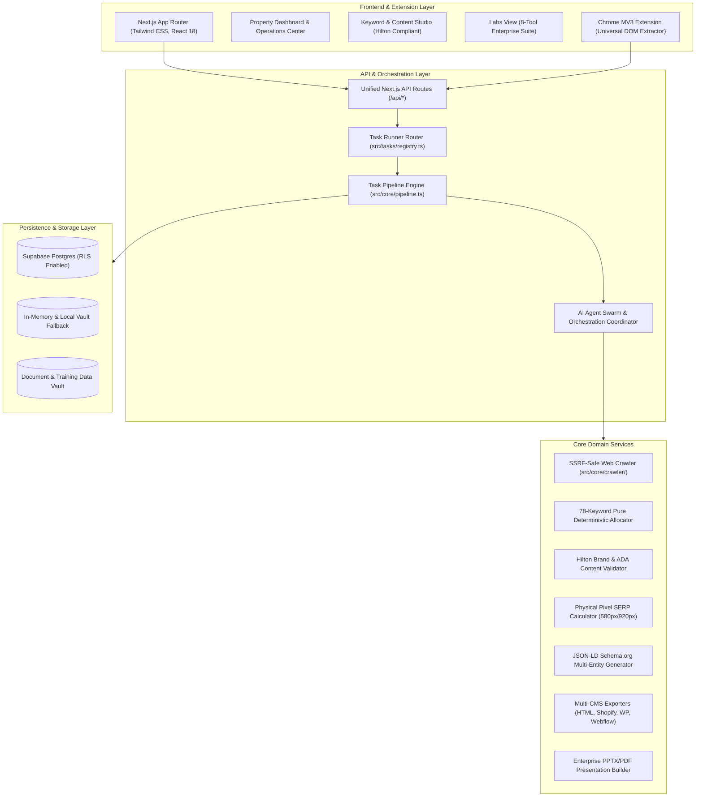

# Architecture Review — SEO Studio Enterprise Platform
**Date:** 2026-11-23  
**Document:** `AUDIT/ARCHITECTURE-REVIEW.md`  
**Status:** Approved Architectural Blueprint  

---

## 1. System Architecture Overview

SEO & GEO Studio follows a hybrid, decoupled architecture designed for high resiliency, local execution capabilities, and enterprise cloud persistence:

---

## 2. Layer-by-Layer Architectural Assessment

### 2.1 Frontend & User Experience Layer
- **State Management**: Built on idiomatic React state (`useState`, `useCallback`, `useMemo`) with local storage hydration for offline tolerance.
- **Rendering Strategy**: Next.js App Router with hybrid SSR and client-side interactivity (`"use client"`).
- **Design System**: Strict Tailwind CSS with mobile-first breakpoints (`sm:`, `md:`, `lg:`, `xl:`), dark mode support, accessible contrast ratios, and tabular numerals for analytics.
- **Architectural Debt**: `PropertyDashboard.tsx` acts as an oversized container holding multiple modal declarations and subviews. Splitting into dedicated modular sub-components (Analytics, TaskMatrix, PropertySwitcher, IntelligenceTabs) improves maintainability and tree-shaking.

### 2.2 Task Pipeline & Execution Layer (`src/core/pipeline.ts`)
The core pipeline follows a strictly typed 5-stage lifecycle:
1. **Input Validation**: Validates raw payloads against Zod schemas before running any business logic.
2. **Data Fetching**: Pulls verified data sources (prior crawl pages, keyword pools, property facts).
3. **Claude LLM Generation**: Executes generation using `@anthropic-ai/sdk` with strict `temperature: 0.2` for deterministic output.
4. **Validation & Automated Retry**: Executes automated rule checkers (Hilton brand rules, character bounds, ADA compliance). If validation flags are raised, feedback is fed back to the LLM for up to 2 automated retries before setting the status to `Flagged`.
5. **Template Rendering & Output Persistence**: Generates documents (Docs, Sheets, Slides, JSON) and records flags in `task_runs`.

### 2.3 Crawler & Property Intelligence Layer (`src/core/crawler/`)
- **SSRF Protection**: `src/core/crawler/ssrf.ts` parses URLs, enforces `http`/`https` protocols, resolves DNS, and rigorously blocks loopback (`127.0.0.0/8`, `::1`), RFC 1918 private IPv4 subnets, link-local, multicast, and metadata service IP addresses (`169.254.169.254`).
- **Discovery**: Automatically fetches `robots.txt` and locates XML sitemaps through `Sitemap:` directives.
- **Chunked Queue**: Crawl state is divided into chunks allowing resuming without hitting serverless timeout limits.

### 2.4 Database Architecture & Data Isolation (`supabase/migrations/`)
- **Existing Schemas**:
  - `properties`: Hotel profiles with brand, location, allowed/excluded geo modifiers.
  - `runs`: Keyword research runs with status (`draft`, `approved`, `report_generated`).
  - `run_keywords`: 78 allocated keywords per run with roles (`primary`, `secondary`, `fill`, `reserve`).
  - `run_matrix`: Page-to-keyword allocations with approved statuses.
  - `task_runs`: Execution logs for all 22 tasks.
  - `crawl_runs` & `crawl_pages`: Deep extracted site facts and status codes.
  - `ai_training_rules`: Grounded rules for prompt injection.
- **Enterprise Multi-Tenancy Upgrade Required**:
  - Add `clients` table: Links multiple properties under agency clients.
  - Add `property_groups` / `portfolios`: Enables cross-property benchmarking.
  - Add `user_roles` & `memberships`: Enforces RBAC (`admin`, `manager`, `specialist`, `client`).
  - Add `competitors` & `competitor_metrics`: Houses competitor URLs, keywords, and share of voice.
  - Add `backlink_records` & `outreach_campaigns`: Houses off-page link targets and outreach statuses.
  - Add `geo_observations`: Records live AI search results, citations, and platform visibility.

---

## 3. Security & Compliance Architecture

| Security Dimension | Current Implementation | Target Enterprise Standard |
|---|---|---|
| **SSRF Mitigation** | Strict private IP regex and DNS verification | Comprehensive allowlist + Cloudflare edge proxy |
| **XSS Prevention** | Context-aware HTML entity escaping (`validators/xssProtection.ts`) | Strict Content Security Policy (CSP) headers + DOMPurify |
| **API Auth & RBAC** | Service-role key for backend operations | JWT session validation + Role-Based Access Control middleware |
| **Data Isolation** | RLS enabled on all Postgres tables | Tenant-scoped RLS policies (`tenant_id = auth.jwt()->>'client_id'`) |
| **Secret Protection** | `.env.local` ignored, CI secret scanner active | Zero secret leakage, KMS encrypted storage for third-party keys |

---

## 4. Architectural Recommendations

1. **Implement Missing 11 Tasks in Task Registry**: Complete full pipeline implementations for all `Not started` tasks to eliminate `ComingSoonModal`.
2. **Build First-Class Client & Multi-Property Data Layer**: Extend schema and services to support agency multi-client management with seamless property switching.
3. **Formalize AI Agent Swarm Architecture**: Create 13 modular AI agents coordinating through a centralized pipeline with explicit human-in-the-loop approval gates.
4. **Deploy Enterprise BI & Reporting Suite**: Build interactive executive presentations and multi-format exports (PPTX, PDF, CSV, CMS formats) connected to verified data.
