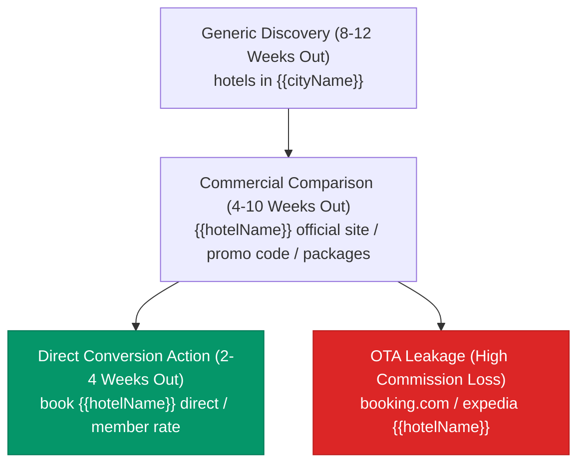

# Direct Booking Engine & OTA Displacement Playbook

A high-conversion on-page framework engineered to shift high-intent hospitality searchers from high-commission Online Travel Agencies (Expedia, Booking.com, Hotels.com, Priceline, Agoda) directly to the hotel's proprietary booking engine. Captures traveler demand 4 to 10 weeks prior to arrival while providing clear justification for booking direct.

---

## 1. Pre-Booking Window Keyword Strategy (4–10 Weeks Out)

Travelers begin evaluating destination accommodations 30 to 75 days before departure. During this critical window, search queries shift from generic destination discovery to commercial comparison terms. This strategy intercepts traffic before travelers finalize OTA transactions.

### 1.1 Booking Funnel Keyword Architecture



### 1.2 Target Keyword Matrix & Search Intent

| Booking Window | Keyword Category | Target Search Query Patterns | On-Page Page Target | Primary Conversion Hook |
|---|---|---|---|---|
| **6–10 Weeks Out** | **Official Site Verification** | `{{hotelName}} official site`<br>`{{hotelName}} direct website` | Homepage / Brand Overview | Canonical trust badge + Best Rate Guarantee |
| **4–8 Weeks Out** | **Package & Value Incentives** | `{{cityName}} hotel packages with breakfast`<br>`{{hotelName}} parking package` | Special Offers & Packages | Bundled value unavailable on third-party OTAs |
| **4–6 Weeks Out** | **Promo & Discount Queries** | `{{hotelName}} discount code`<br>`{{hotelName}} promo code`<br>`{{hotelName}} aaa aarp rate` | Offers & Direct Deals Page | Transparent member rates matching or beating public coupons |
| **2–4 Weeks Out** | **Policy & Flexibility Verification** | `{{hotelName}} cancellation policy`<br>`{{hotelName}} check in time early` | FAQ / Booking Terms | 24-Hour flexible cancellation vs. strict OTA non-refundable rules |

---

## 2. Direct Booking vs. Third-Party OTA Comparison Matrix

Present this clear, side-by-side comparison table on your property overview, offers, and booking engine gateway pages to remove any incentive for travelers to book on OTAs.

| Feature & Guest Benefit | Booking Directly on {{brandDomain}} | Booking via Third-Party OTAs (Expedia, Booking.com) |
|---|---|---|
| **Lowest Price Guarantee** | **Guaranteed Lowest Public Rate**<br>Matches any verified lower public rate + extra 25% discount or 5,000 bonus points | Subject to platform commissions and hidden booking fees at final checkout |
| **Cancellation & Date Flexibility** | **Flexible 24-Hour Cancellation**<br>Cancel or modify reservation up to 24 hours prior to arrival with zero penalty fees | Often locked into rigid non-refundable policies or complex third-party change vouchers |
| **Loyalty Points & Tier Credits** | **Full {{loyaltyProgram}} Point Accrual**<br>Earn elite night credits, bonus points, and tier milestone perks | **Zero Loyalty Points**<br>Third-party reservations are excluded from tier upgrades and points |
| **Room Selection & Preferences** | **Priority Room Allocation**<br>Choose specific floor, high-floor view, bed configuration, and adjoining rooms | "Run of House" inventory; room placement is assigned last upon guest arrival |
| **Direct Customer Support** | **Direct Access to Hotel Front Desk**<br>Modify check-in times or request upgrades directly with our local team | Rerouted through offshore third-party call centers with multi-hour wait times |
| **Hidden Surcharge Protection** | **Transparent All-Inclusive Pricing**<br>Itemized taxes, parking fees, and amenity access clearly stated upfront | Hidden resort fees, platform service surcharges, or foreign currency conversion fees |

---

## 3. High-Converting H2/H3 Layout Modules

### 3.1 Module A: Best Rate Guarantee & Direct Booking Hook
```html
<section class="direct-booking-hero">
  <div class="guarantee-badge">OFFICIAL HOTEL SITE GUARANTEE</div>
  <h2>Why Booking Direct at {{hotelName}} Guarantees the Best Stay</h2>
  <p class="lead">
    Third-party booking websites charge up to 20% in distributor markups and limit your flexibility. When you reserve your stay directly through {{brandDomain}} or by calling our local team at {{localPhoneNumber}}, you secure exclusive rates and personalized service.
  </p>

  <div class="perks-grid">
    <div class="perk-card">
      <h3>Guaranteed Lowest Rate</h3>
      <p>If you find a lower qualified public rate for the same room type and dates within 24 hours of booking, we will match it and discount it further.</p>
    </div>
    <div class="perk-card">
      <h3>Full {{loyaltyProgram}} Privileges</h3>
      <p>Earn points toward reward nights, redeem member rates, and enjoy complimentary mobile key check-in and priority Wi-Fi.</p>
    </div>
    <div class="perk-card">
      <h3>No-Penalty Flexibility</h3>
      <p>Travel plans change. Manage your reservation directly with our front desk team with flexible cancellation windows up to 24 hours before check-in.</p>
    </div>
  </div>
</section>
```

---

### 3.2 Module B: Exclusive Direct Bundles & Packages
```html
<section class="exclusive-packages">
  <h2>Offers Exclusive to Direct Bookers</h2>
  <p>These curated stay packages cannot be booked through Expedia, Booking.com, or third-party travel platforms:</p>

  <div class="package-columns">
    <article class="package-item">
      <h3>{{packageTitle1}} (Breakfast & Parking Included)</h3>
      <p>{{packageDescription1}}</p>
      <ul>
        <li>Complimentary on-site self-parking for one vehicle (save ${{parkingRate}}/night)</li>
        <li>Full daily hot breakfast for up to two registered guests</li>
        <li>Late check-out up to 1:00 PM (subject to availability)</li>
      </ul>
      <a href="{{directBookingUrl}}?package={{packageCode1}}" class="btn-primary">Check Direct Availability</a>
    </article>

    <article class="package-item">
      <h3>{{packageTitle2}} (Family Adventure & Attraction Pass)</h3>
      <p>{{packageDescription2}}</p>
      <ul>
        <li>Spacious two-room suite with private balcony near {{primaryAttraction}}</li>
        <li>Discounted tickets or vouchers to top local {{cityName}} attractions</li>
        <li>Welcome amenity for children upon arrival</li>
      </ul>
      <a href="{{directBookingUrl}}?package={{packageCode2}}" class="btn-primary">Reserve Family Package</a>
    </article>
  </div>
</section>
```

---

## 4. CRO Micro-Copy Slots & Risk-Reversal Badges

Micro-copy placed adjacent to booking widgets, room rate tables, and CTA buttons reduces cart abandonment and prevents travelers from bouncing back to Google or OTAs.

### 4.1 Primary CTA Button Text & Subtext Slots

| Placement | Primary Button Copy | Supporting Micro-Copy (Directly Below CTA) |
|---|---|---|
| **Hero Booking Widget** | `Check Direct Availability & Rates` | *Best Rate Guaranteed | Instant Confirmation Directly with Hotel Front Desk* |
| **Room Details Card** | `Select Room & Lock in Member Rate` | *Members save up to 10% | Free cancellation until 4:00 PM 1 day prior* |
| **Special Offers Banner** | `Claim Exclusive Direct Package` | *Only available when booking on {{brandDomain}} | No hidden third-party fees* |
| **Header Sticky Navigation** | `Book Direct & Save` | *Earn {{loyaltyProgram}} Points on Every Stay* |

---

### 4.2 Reusable Trust & Risk-Reversal Micro-Badges

```html
<!-- Risk Reversal Strip (Insert below rate selection or sticky footer) -->
<div class="trust-signal-strip">
  <div class="trust-item">
    <span class="trust-title">Zero Hidden Booking Fees</span>
    <span class="trust-desc">What you see is what you pay at checkout</span>
  </div>
  <div class="trust-item">
    <span class="trust-title">24-Hour Cancellation Window</span>
    <span class="trust-desc">Flexible travel protection on standard rates</span>
  </div>
  <div class="trust-item">
    <span class="trust-title">Official Brand Confirmation</span>
    <span class="trust-desc">Your reservation is instantly entered into our property management system</span>
  </div>
  <div class="trust-item">
    <span class="trust-title">Best Price Promise</span>
    <span class="trust-desc">Found a lower rate? We will match it and discount it by 25%</span>
  </div>
</div>
```

---

### 4.3 Exit-Intent & Cart Abandonment Interception Modal
*Triggered when a user hovers their mouse toward the browser back/close button or navigates away toward an OTA:*

* **Headline**: Wait! Get the Guaranteed Lowest Rate on Your {{cityName}} Stay
* **Body Copy**: 
  > "Before you check Expedia or Booking.com, remember that third-party sites cannot offer our {{loyaltyProgram}} member discounts or flexible 24-hour cancellation privileges. Complete your reservation directly with us today to lock in your room at the guaranteed lowest rate."
* **Primary Action**: `Lock in Direct Member Rate` (Links to direct booking funnel)
* **Secondary Action**: `Continue Browsing`
