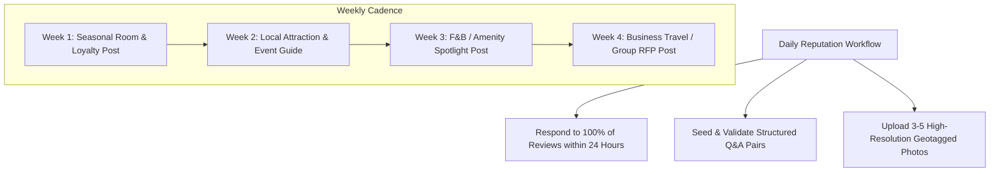

# Hotel Google Business Profile (GBP) & UNAP Local SEO Audit Engine

A structured operational framework designed for hospitality local search optimization, multi-platform citation governance, and Google Maps Local 3-Pack authority. Built to comply simultaneously with Google Business Profile policies and corporate franchisor guidelines (**Marriott International**, **Hilton Worldwide**, **IHG Hotels & Resorts**, and **Hyatt Hotels Corporation**).

---

## 1. Primary & Secondary GBP Category Architecture

Category selection directly dictates ranking eligibility in Google Maps and the Local 3-Pack. Hospitality properties must configure one primary category matching their operational core, supported by strategic secondary categories that unlock specific amenity attributes.

### 1.1 Category Decision Matrix

| Property Profile | Recommended Primary Category | Approved Secondary Categories | Attribute Unlocks |
|---|---|---|---|
| **Full-Service Commercial Hotel** | `Hotel` | `Conference center`, `Meeting room`, `Restaurant`, `Lounge` | Business center, room service, on-site event booking |
| **Resort & Beachfront Destination** | `Resort hotel` | `Hotel`, `Extended stay hotel`, `Event venue`, `Swimming pool` | Resort activities, cabanas, seasonal recreation, beach access |
| **All-Suite & Extended Stay Flag** | `Extended stay hotel` | `Hotel`, `Self-service laundry`, `Furnished apartment building` | In-suite kitchens, stovetops, full refrigerators, laundry |
| **Meetings & Convention Anchor** | `Conference center` | `Hotel`, `Banquet hall`, `Event venue`, `Meeting room` | Floor plans, A/V equipment, catering packages, capacity |
| **Lifestyle & Boutique Flag** | `Boutique hotel` | `Hotel`, `Cocktail bar`, `Lounge`, `Bistro` | Architectural styling, craft dining, rooftop spaces |

### 1.2 Multi-Department Listing Hierarchy
Properties operating distinct food & beverage outlets, spas, or convention wings must create dedicated subordinate Google Business Profiles nested within the primary hotel listing:
1. **Primary Lodging Profile**: Caters to room stays (`{{hotelName}}`).
2. **On-Site Restaurant / Rooftop Bar Profile**: Must have its own distinct local entrance, website menu URL, separate local telephone extension, and category (`Restaurant`, `Bar`, `Seafood restaurant`).
3. **Full-Service Spa Profile**: Requires dedicated telephone line, operating hours, and category (`Day spa`, `Spa and health club`).

---

## 2. Brand-Compliant Naming Rules & Anti-Suspension Guardrails

Google enforces strict guidelines prohibiting keyword stuffing in business titles. Concurrently, franchisors audit GBP listings against trademark standards. Violating either can cause profile suspension or brand compliance fines.

### 2.1 Corporate Brand Guidelines vs. Google Policy

| Brand Flag | Corporate Permitted Naming | Google Policy Restrictions | Compliant GBP Listing Name |
|---|---|---|---|
| **Marriott International** | Must match MARSHA hotel name and property signage exactly | No tagline appendages (e.g., "Best Beachfront Pool") | `{{brandName}} {{cityName}}` or `{{hotelName}}` |
| **Hilton Worldwide** | Full brand collection naming (e.g., "Tapestry Collection by Hilton") | City names permitted only if part of official legal/signage name | `{{hotelName}}, {{brandName}}` |
| **IHG Hotels & Resorts** | Must specify exact flag ("Holiday Inn Express & Suites") | Cannot abbreviate ("HIX") or add descriptor spam | `{{hotelName}}` |
| **Hyatt Hotels Corporation** | "Hyatt Place" or "Hyatt House" followed by location designator | No promotional text ("Free Breakfast Near Airport") | `{{hotelName}}` |

### 2.2 Prohibited vs. Compliant Title Patterns
* **Prohibited (High Suspension Risk)**:
  - `{{brandName}} {{cityName}} - Best Oceanfront Hotel Free Breakfast & Parking`
  - `{{brandName}} Downtown Suites near {{conventionCenter}}`
  - `Cheap Hotels in {{cityName}} | {{hotelName}}`
* **Compliant (100% Policy-Safe)**:
  - `{{hotelName}}`
  - `{{hotelName}} at {{airportOrCenterName}}` (only if matching exterior building signage)

---

## 3. UNAP (URL, Name, Address, Phone) Multi-Platform Audit

Local pack algorithms calculate citation consensus across primary platforms. Variations in street abbreviation, suite numbers, or phone numbers dilute localized entity trust.

### 3.1 Target Citation Ecosystem Audit Table

| Platform | Target Profile URL | Listed Business Name | Listed Physical Address | Listed Phone Number | Pin Lat/Long Status | Verified Date |
|---|---|---|---|---|---|---|
| **Google Business Profile** | `{{canonicalUrl}}?utm_source=google&utm_medium=organic&utm_campaign=gbp` | `{{canonicalHotelName}}` | `{{streetAddress}}, {{cityName}}, {{stateCode}} {{postalCode}}` | `{{localDirectPhone}}` | Verified accurate | `{{auditDate}}` |
| **Apple Maps (Business Connect)** | `{{canonicalUrl}}` | `{{canonicalHotelName}}` | `{{streetAddress}}, {{cityName}}, {{stateCode}} {{postalCode}}` | `{{localDirectPhone}}` | Verified accurate | `{{auditDate}}` |
| **TripAdvisor** | `{{tripadvisorUrl}}` | `{{canonicalHotelName}}` | `{{streetAddress}}, {{cityName}}, {{stateCode}} {{postalCode}}` | `{{localDirectPhone}}` | Verified accurate | `{{auditDate}}` |
| **Bing Places** | `{{canonicalUrl}}?utm_source=bing&utm_medium=organic&utm_campaign=bingplaces` | `{{canonicalHotelName}}` | `{{streetAddress}}, {{cityName}}, {{stateCode}} {{postalCode}}` | `{{localDirectPhone}}` | Verified accurate | `{{auditDate}}` |
| **Expedia** | `{{expediaUrl}}` | `{{canonicalHotelName}}` | `{{streetAddress}}, {{cityName}}, {{stateCode}} {{postalCode}}` | `{{localDirectPhone}}` | Verified accurate | `{{auditDate}}` |
| **Booking.com** | `{{bookingUrl}}` | `{{canonicalHotelName}}` | `{{streetAddress}}, {{cityName}}, {{stateCode}} {{postalCode}}` | `{{localDirectPhone}}` | Verified accurate | `{{auditDate}}` |
| **Brand.com Directory** | `{{canonicalUrl}}` | `{{canonicalHotelName}}` | `{{streetAddress}}, {{cityName}}, {{stateCode}} {{postalCode}}` | `{{localDirectPhone}}` | Verified accurate | `{{auditDate}}` |

### 3.2 Key UNAP Governance Standards
1. **Local Direct Phone vs. 1-800 Central Reservations**:
   - The primary telephone number must utilize the local market area code (`{{localDirectPhone}}`). Central 800/888 call-center numbers weaken local geographic relevance.
2. **Canonical Destination Tracking URL**:
   - The primary website button must link directly to the property's specific overview landing page, never a brand homepage or multi-property search results grid.
   - Attach clean attribution tagging: `?utm_source=google&utm_medium=organic&utm_campaign=gbp_listing`.
3. **Map Pin Precision**:
   - Verify that the map marker pin is placed over the physical guest registration lobby / porte-cochère, not the center of an adjacent highway or parking lot.

---

## 4. Monthly GBP Posts, Q&A, and Review-Response Workflow

Active engagement signals freshness and operational responsiveness to Google's ranking algorithms.

### 4.1 Weekly Google Posts Publishing Schedule

#### Week 1: Direct Booking & Loyalty Value Post (Type: Offer / What's New)
* **Visual**: Clean twilight exterior or executive suite photography.
* **Copy (80–100 words)**:
  > "Planning your next getaway to {{cityName}}? Enjoy the guaranteed lowest rate and flexible booking when reserving direct at {{hotelName}}. Members of {{loyaltyProgram}} earn points toward free nights and access exclusive member rates, complimentary high-speed Wi-Fi, and early check-in options. Explore our beachfront suites just steps from {{primaryAttraction}}."
* **CTA Button**: `Book` (URL: `{{canonicalUrl}}?utm_source=gbp&utm_medium=post&utm_campaign=loyalty_offer`)

#### Week 2: Local Attraction & Event Anchor Post (Type: Event / What's New)
* **Visual**: Property proximity map or high-quality nearby landmark imagery.
* **Copy (80–100 words)**:
  > "Visiting {{cityName}} for {{upcomingLocalEvent}}? {{hotelName}} is located just {{distanceToEvent}} from {{eventVenue}}, offering comfortable accommodations after a full day of events. Wake up to complimentary hot breakfast, unwind in our {{poolDescription}}, and enjoy direct access to top dining in {{diningDistrict}}. Rooms fill quickly for event weekends—reserve early."
* **CTA Button**: `Book` (URL: `{{canonicalUrl}}?utm_source=gbp&utm_medium=post&utm_campaign=local_event`)

#### Week 3: Amenity & Relaxation Spotlight (Type: What's New)
* **Visual**: Resort swimming pool, outdoor fire pit, or fitness center photography.
* **Copy (80–100 words)**:
  > "Relax and recharge at {{hotelName}}. Whether traveling for business or leisure in {{cityName}}, our property features a {{poolDescription}}, 24/7 modern fitness facility, and pet-friendly guestrooms. Start your morning with fresh waffles and artisanal coffee before exploring {{secondaryAttraction}}."
* **CTA Button**: `Learn More` (URL: `{{canonicalUrl}}#amenities`)

#### Week 4: Business & Group Travel Hook (Type: What's New)
* **Visual**: Ergonomic in-room workspace or meeting boardroom setup.
* **Copy (80–100 words)**:
  > "Simplify corporate travel to {{cityName}}. {{hotelName}} provides quiet suites with ergonomic work desks, fast 100 Mbps fiber Wi-Fi, and {{meetingSpaceSqFt}} sq ft of professional meeting space minutes from {{businessParkOrConventionCenter}}. Contact our sales team today to secure corporate group room blocks."
* **CTA Button**: `Call Now` (Direct local sales line)

---

### 4.2 Proactive Q&A Seeding Protocol
Google allows businesses to populate and answer their own public Q&A section. Seed these high-value queries directly from the hotel's Google account to prevent misinformation:

1. **Question**: *Does {{hotelName}} offer free breakfast?*
   - **Approved Owner Answer**: "Yes. {{hotelName}} serves a complimentary daily hot breakfast to all registered guests from 6:30 AM to 9:30 AM on weekdays and 7:00 AM to 10:00 AM on weekends, featuring scrambled eggs, waffles, fresh fruit, oatmeal, and premium coffee."
2. **Question**: *What are the parking rates and EV charging options?*
   - **Approved Owner Answer**: "Self-parking is available on-site for ${{parkingRate}} per vehicle per night with 24-hour in-and-out access. We also provide {{evChargerCount}} Level-2 EV charging stations complimentary for guest use."
3. **Question**: *How far is the hotel from {{primaryAttraction}}?*
   - **Approved Owner Answer**: "{{hotelName}} is located {{distanceMiles}} miles from {{primaryAttraction}}, which is approximately a {{walkingMinutes}}-minute walk or a {{drivingMinutes}}-minute drive via {{primaryStreetRoute}}."

---

### 4.3 Review Response Playbook (24-Hour SLA)

#### Positive 5-Star Review Response Template
> "Thank you for sharing your experience at {{hotelName}}, {{guestName}}! We are thrilled to hear you enjoyed our {{citedAmenityOrFeature}} and our convenient location near {{localAttraction}}. Our team strives to provide memorable stays for visitors to {{cityName}}, and we look forward to welcoming you back on your next visit!"

#### Constructive / Negative Review Response Template
> "Dear {{guestName}}, thank you for taking the time to provide your feedback. We regret that your recent stay did not meet our standard of hospitality, specifically regarding {{specificIssueMentioned}}. We take maintenance and guest comfort seriously and have shared this directly with our leadership team. We would appreciate the opportunity to make this right—please contact our General Manager directly at {{gmEmailOrDirectPhone}} so we can assist you."
