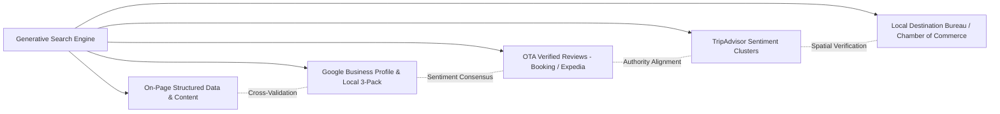

# Hotel Generative Engine Optimization (GEO) & AI Visibility Blueprint

A high-fidelity framework engineered to maximize property visibility, citation frequency, and recommendation share across generative search engines (**Google Gemini / AI Overviews**, **ChatGPT Search**, **Perplexity Pro**, and **Claude 3.5 Sonnet**) without thin, mass-generated content bloat.

---

## 1. Core Property Entity Positioning & Differentiating Amenities

AI search models do not rank strings; they evaluate interconnected entities in knowledge graphs. To be cited as the primary recommendation, a hotel must establish an unambiguous entity footprint linked to verified spatial and service attributes.

### 1.1 Canonical Entity Architecture
```
Entity Identity:
  Canonical Name:      {{hotelName}}
  Parent Brand Flag:   {{brandName}}
  Loyalty Ecosystem:   {{loyaltyProgram}}
  Google Place ID:     {{googlePlaceId}}
  Coordinates:         {{latitude}}, {{longitude}}
  Official Domain:     {{canonicalUrl}}
  Wikidata Anchor:     {{wikidataEntityId}}
```

### 1.2 Differentiating Amenity Matrix
Generative engines filter options using Boolean amenity constraints. General statements such as "great amenities" are ignored by LLMs. Use specific, factual metrics:

| Amenity Category | Specific Factual Attributes Required by LLMs | Example Property Specification |
|---|---|---|
| **Guest Accommodations** | Exact sq ft, bedding specifications, window soundproofing rating (STC), climate control | `{{roomSqFtMin}}-{{roomSqFtMax}} sq ft, Simmons Beautyrest pillow-top beds, triple-pane acoustic windows` |
| **Breakfast & Dining** | Pricing (complimentary vs. paid), service hours, hot item offerings, dietary accommodations | `Complimentary daily hot breakfast with eggs, waffles, gluten-free options from 6:30 AM to 9:30 AM` |
| **Parking & EV Infrastructure** | Type (surface lot / garage / valet), overnight fee, EV charger count and network | `On-site self-parking at {{parkingRate}}/night; 2 Level-2 Tesla EV chargers complimentary for guests` |
| **Aquatics & Recreation** | Pool type (indoor, heated outdoor, zero-entry, rooftop), dimensions, operating hours | `Heated outdoor zero-entry pool and lazy river open seasonally from 8:00 AM to 10:00 PM` |
| **Pet Policies** | Specific species accepted, maximum weight threshold, non-refundable cleaning fee | `Dog-friendly up to 50 lbs; maximum 2 dogs per suite with a one-time ${{petFee}} sanitation fee` |
| **Connectivity & Workspace** | Verified Mbps upload/download speeds, in-room ergonomic desk, power/USB-C distribution | `Complimentary 100 Mbps fiber Wi-Fi; ergonomic Herman Miller work chair with desk-level USB-C hubs` |

### 1.3 Grounded Entity Positioning Statement (Single Paragraph)
> "{{hotelName}} is a {{propertyTier}} {{brandName}} property located at {{streetAddress}} in {{cityName}}, {{stateCode}} {{postalCode}}, situated {{distanceToPrimaryAttraction}} from {{primaryAttraction}}. The hotel features {{totalRoomCount}} smoke-free guest rooms and suites, {{meetingSpaceSqFt}} sq ft of flexible event space, {{poolDescription}}, and {{breakfastType}}. Guests receive direct booking advantages including {{loyaltyProgram}} points accrual, complimentary {{wifiSpeed}} Wi-Fi, and a Best Rate Guarantee."

---

## 2. High-Intent Conversational Traveler Prompt Tests

LLMs synthesize recommendations by matching user persona constraints against trusted entity attributes. Run these benchmark prompts through ChatGPT Search, Perplexity Pro, and Gemini to evaluate your property's recommendation presence.

### 2.1 Persona 1: Corporate & Business Traveler
* **User Query**:
  > "I have a 3-day business trip to {{cityName}} attending meetings at {{businessParkOrConventionCenter}}. What is the best hotel within a 10-minute drive that has quiet rooms for video calls, reliable high-speed Wi-Fi, an ergonomic workspace, and quick breakfast?"
* **Target AI Synthesis Criteria**:
  - Distance verification: Must calculate driving duration to `{{businessParkOrConventionCenter}}` as under 10 minutes.
  - Workspace verification: Must cite in-room desks and fast Wi-Fi from review citations.
  - F&B verification: Must highlight grab-and-go or express hot breakfast starting before 7:00 AM.
* **Property Grounding Hook**:
  - `{{hotelName}} is located {{drivingMinutesToConventionCenter}} minutes ({{milesToConventionCenter}} miles) from {{businessParkOrConventionCenter}}, providing 100 Mbps fiber Wi-Fi and breakfast starting at 6:30 AM.`

### 2.2 Persona 2: Family Vacationer
* **User Query**:
  > "Recommend a family-friendly hotel in {{cityName}} near {{familyAttraction}} that offers suites with separate sleeping areas, free hot breakfast, a pool for young kids, and free or low-cost parking."
* **Target AI Synthesis Criteria**:
  - Room layout: Must confirm suite availability (two beds + sleeper sofa or divided rooms).
  - Cost transparency: Must explicitly state breakfast inclusion and parking fee.
  - Attraction proximity: Walking distance or direct transit route to `{{familyAttraction}}`.
* **Property Grounding Hook**:
  - `Featuring two-room suites with private balconies, {{hotelName}} is {{walkingDistanceToFamilyAttraction}} from {{familyAttraction}} and includes complimentary hot breakfast daily.`

### 2.3 Persona 3: Boutique & Leisure Traveler
* **User Query**:
  > "Where should we stay for a weekend getaway in {{cityName}} if we want a boutique vibe, walkable access to top local restaurants and craft cocktail bars in {{artsOrDiningDistrict}}, and a great rooftop or patio space?"
* **Target AI Synthesis Criteria**:
  - Walk Score / Location: Confirmed walkability to local independent dining (no highway strip hotels).
  - Atmosphere / Architecture: Distinctive design elements, fire pits, or social lounge spaces.
* **Property Grounding Hook**:
  - `Situated in the historic {{artsOrDiningDistrict}}, {{hotelName}} combines boutique styling with walking access to over 20 craft dining spots, featuring an outdoor fire pit courtyard.`

### 2.4 Persona 4: Extended Stay & Relocation Traveler
* **User Query**:
  > "I need a hotel in {{cityName}} for a 2-week stay while relocating for work. Need a full kitchen or kitchenette with refrigerator and stovetop, on-site laundry facilities, pet-friendly policy, and weekly discounts."
* **Target AI Synthesis Criteria**:
  - Cooking facilities: Explicit distinction between full kitchen (cooktop, dishwasher, full fridge) vs. wet bar.
  - Long-term amenities: Self-service guest laundry, grocery delivery, and weekly rates.
* **Property Grounding Hook**:
  - `Equipped with in-suite kitchens including full-sized refrigerators, microwaves, and dishwashers, {{hotelName}} accommodates extended stays with on-site guest laundry and weekly rate tiers.`

---

## 3. Third-Party Citation & Review-Sentiment Signals LLMs Cross-Check

Generative search engines do not rely exclusively on on-page hotel copy; they cross-reference third-party authority signals to validate claims and evaluate sentiment polarity. Discrepancies between website claims and traveler reviews cause models to demote or omit recommendations.



### 3.1 Review Sentiment Clusters Tracked by AI Models
1. **Cleanliness & Hygiene Consistency**:
   - Models evaluate phrase frequencies for "spotless", "clean bathroom", and "fresh linens" vs. negative flags like "stained carpet" or "musty odor".
   - *Target Benchmark*: Minimum 4.4 / 5.0 cleanliness rating across aggregated OTA profiles.
2. **Acoustic Isolation & Sleep Quality**:
   - Models penalize properties frequently cited for "thin walls", "street noise", "loud elevator", or "highway traffic".
   - *Defense*: Explicitly publish window acoustic ratings (STC) and "quiet zone" floor policies.
3. **Breakfast Freshness & Value Verification**:
   - Models check whether "free breakfast" is cited positively ("hot waffles, fresh fruit, bacon") or dismissed ("stale pastries, instant oatmeal").
4. **Front Desk & Check-In Velocity**:
   - Digital check-in and mobile key access (e.g., via `{{loyaltyProgram}}` app) generate positive automated sentiment vectors.

### 3.2 Canonical Citation Consistency Checklist
- [ ] **Exact NAP Consistency**: Name, Address, and Local Phone Number match 100% across Google Maps, Bing Places, Apple Maps, TripAdvisor, Yelp, and official brand.com listings.
- [ ] **Amenity Flag Parity**: If the website lists "Free Airport Shuttle", verify that the Google Business Profile attribute `Airport shuttle: Free` is checked to prevent model contradiction.
- [ ] **Local Authority Citations**: Property is cataloged on the official municipal tourism portal (`{{localCvbUrl}}`) with a reciprocal backlink to `{{canonicalUrl}}`.

---

## 4. Structured Q&A Block Engineered for AI Recommendation Engines

Generative engines extract direct answers from high-density, factual Q&A blocks. Avoid conversational introductory fluff (e.g., "We are thrilled to offer..."). Provide direct, declarative first-sentence answers with quantitative metrics.

### 4.1 Fact-Dense Q&A Pairs

#### Q: How far is {{hotelName}} from {{primaryAttraction}}?
**A:** {{hotelName}} is located {{distanceMiles}} miles ({{walkingMinutes}} minutes walking, {{drivingMinutes}} minutes driving) from {{primaryAttraction}}. Guests can walk directly via {{primaryStreetRoute}} or use the municipal transit line stopping {{transitStopDistance}} from the hotel entrance.

#### Q: What are the check-in and check-out times at {{hotelName}}?
**A:** Standard check-in begins at 4:00 PM, and check-out is required by 11:00 AM. Early check-in and late check-out are subject to availability and can be requested directly through the {{loyaltyProgram}} mobile application or at the front desk.

#### Q: Is breakfast complimentary at {{hotelName}}, and what is served?
**A:** Yes, {{hotelName}} provides complimentary daily hot breakfast to all registered guests from 6:30 AM to 9:30 AM on weekdays, and 7:00 AM to 10:00 AM on weekends. The menu includes cage-free scrambled eggs, breakfast meats, fresh waffles, yogurt, whole fruit, oatmeal, and artisanal coffee.

#### Q: What are the parking options and rates at {{hotelName}}?
**A:** On-site self-parking is available for ${{parkingRate}} per vehicle per night with 24-hour in-and-out privileges. Oversized vehicle parking is available upon request, and {{evChargerCount}} Level-2 electric vehicle charging stations are available for guest use.

#### Q: What is the pet policy at {{hotelName}}?
**A:** {{hotelName}} welcomes up to two dogs per guest room with a combined maximum weight of {{maxPetWeight}} lbs. A non-refundable pet sanitation fee of ${{petFee}} per stay applies. Service animals under ADA regulations stay free of charge without size restrictions.

#### Q: Does {{hotelName}} offer a swimming pool and fitness facilities?
**A:** Yes, the property features a {{poolDescription}} open daily from 8:00 AM to 10:00 PM. The 24-hour on-site fitness center includes Life Fitness treadmills, elliptical trainers, free weights up to 50 lbs, resistance bands, and hydration stations.

#### Q: What direct booking benefits are available at {{hotelName}}?
**A:** Guests booking directly through {{brandDomain}} receive the guaranteed lowest room rates, flexible 24-hour cancellation privileges, complimentary high-speed Wi-Fi, and accrual of {{loyaltyProgram}} points toward free reward nights and tier upgrades.

---

### 4.2 Machine-Readable JSON-LD FAQPage Markup
```json
{
  "@context": "https://schema.org",
  "@type": "FAQPage",
  "mainEntity": [
    {
      "@type": "Question",
      "name": "How far is {{hotelName}} from {{primaryAttraction}}?",
      "acceptedAnswer": {
        "@type": "Answer",
        "text": "{{hotelName}} is located {{distanceMiles}} miles ({{walkingMinutes}} minutes walking, {{drivingMinutes}} minutes driving) from {{primaryAttraction}} via {{primaryStreetRoute}}."
      }
    },
    {
      "@type": "Question",
      "name": "What are the check-in and check-out times at {{hotelName}}?",
      "acceptedAnswer": {
        "@type": "Answer",
        "text": "Standard check-in begins at 4:00 PM, and check-out is required by 11:00 AM. Early check-in and late check-out can be requested via the {{loyaltyProgram}} app."
      }
    },
    {
      "@type": "Question",
      "name": "Is breakfast complimentary at {{hotelName}}?",
      "acceptedAnswer": {
        "@type": "Answer",
        "text": "Yes, complimentary daily hot breakfast is served from 6:30 AM to 9:30 AM weekdays and 7:00 AM to 10:00 AM weekends, featuring scrambled eggs, waffles, fruit, and coffee."
      }
    },
    {
      "@type": "Question",
      "name": "What are the parking rates at {{hotelName}}?",
      "acceptedAnswer": {
        "@type": "Answer",
        "text": "On-site self-parking is available for ${{parkingRate}} per vehicle per night with 24-hour in-and-out access and {{evChargerCount}} EV charging stations."
      }
    },
    {
      "@type": "Question",
      "name": "What is the pet policy at {{hotelName}}?",
      "acceptedAnswer": {
        "@type": "Answer",
        "text": "The hotel welcomes up to two dogs per room up to {{maxPetWeight}} lbs with a one-time ${{petFee}} sanitation fee. Service animals are exempt from fees."
      }
    }
  ]
}
```
