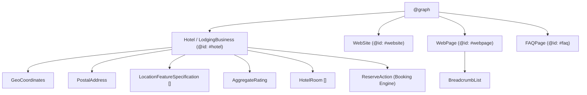

# Hotel & Lodging JSON-LD Schema Architecture

A copy-pasteable, schema.org-compliant JSON-LD structured data library engineered specifically for independent and franchised hotels, resorts, and extended-stay properties. Built to maximize eligibility for Google Hotel Rich Results, Local 3-Pack grounding, Knowledge Graph entity panels, and AI search citation graphs (**Google Gemini / AI Overviews**, **ChatGPT Search**, **Perplexity Pro**).

---

## 1. Unified `@graph` Schema Architecture

Google recommends connecting all related entities within a single top-level `@graph` array rather than scattering disconnected `<script>` tags across the DOM. This establishes clear semantic relationships between the property, its parent website, individual room types, and FAQ rich snippets.



---

## 2. Modular Schema Building Blocks

### Block A: Core `Hotel` / `LodgingBusiness` Entity
*Defines the primary hospitality entity, legal branding, price range, and star classification.*

```json
{
  "@type": "Hotel",
  "@id": "{{canonicalUrl}}#hotel",
  "name": "{{hotelName}}",
  "alternateName": "{{brandCollectionName}}",
  "description": "{{metaDescription}}",
  "url": "{{canonicalUrl}}",
  "telephone": "{{localPhoneNumber}}",
  "priceRange": "{{priceRangeSymbol}}",
  "currenciesAccepted": "USD",
  "paymentAccepted": "Credit Card, Debit Card",
  "starRating": {
    "@type": "Rating",
    "ratingValue": "{{starRatingValue}}"
  },
  "image": [
    "{{heroExteriorImageUrl}}",
    "{{guestRoomImageUrl}}",
    "{{amenityPoolImageUrl}}"
  ]
}
```

---

### Block B: Geographic Coordinates (`geo`) & Physical Address
*Anchors the property to exact geographic coordinates and postal authority boundaries for Google Maps Local Pack inclusion.*

```json
{
  "address": {
    "@type": "PostalAddress",
    "streetAddress": "{{streetAddress}}",
    "addressLocality": "{{cityName}}",
    "addressRegion": "{{stateCode}}",
    "postalCode": "{{postalCode}}",
    "addressCountry": "US"
  },
  "geo": {
    "@type": "GeoCoordinates",
    "latitude": {{latitude}},
    "longitude": {{longitude}}
  }
}
```

---

### Block C: Operational Hours (`checkinTime` & `checkoutTime`)
*Communicates precise guest arrival and departure thresholds to search engines and AI assistants.*

```json
{
  "checkinTime": "16:00:00",
  "checkoutTime": "11:00:00"
}
```

---

### Block D: Granular Amenity Features (`amenityFeature`)
*Uses schema.org's `LocationFeatureSpecification` to define Boolean amenity filters parsed by search engines and OTA aggregators.*

```json
"amenityFeature": [
  {
    "@type": "LocationFeatureSpecification",
    "name": "High-Speed Wi-Fi",
    "value": true
  },
  {
    "@type": "LocationFeatureSpecification",
    "name": "Complimentary Daily Hot Breakfast",
    "value": {{isBreakfastFree}}
  },
  {
    "@type": "LocationFeatureSpecification",
    "name": "Swimming Pool",
    "value": true
  },
  {
    "@type": "LocationFeatureSpecification",
    "name": "24-Hour Fitness Center",
    "value": true
  },
  {
    "@type": "LocationFeatureSpecification",
    "name": "Pet-Friendly Accommodations",
    "value": {{isPetFriendly}}
  },
  {
    "@type": "LocationFeatureSpecification",
    "name": "Level-2 Electric Vehicle (EV) Charging",
    "value": {{hasEvCharging}}
  },
  {
    "@type": "LocationFeatureSpecification",
    "name": "On-Site Self Parking",
    "value": true
  }
]
```

---

### Block E: Authoritative Entity Links (`sameAs`)
*Connects the hotel entity to verified third-party authorities, eliminating entity ambiguity in Knowledge Graphs.*

```json
"sameAs": [
  "{{googleMapsPlaceUrl}}",
  "{{tripadvisorPropertyUrl}}",
  "{{wikidataEntityUrl}}",
  "{{officialBrandDirectoryUrl}}",
  "{{facebookPageUrl}}",
  "{{instagramProfileUrl}}"
]
```

---

### Block F: Verified Traveler Sentiment (`AggregateRating`)
*Integrates verified guest review scores without violating Google's self-serving review guidelines.*

> **Compliance Warning**: Only include `AggregateRating` if the score represents real, verifiable guest reviews sourced directly on-site or aggregated legitimately. Do not fabricate scores or copy third-party OTA ratings directly into schema without explicit syndication agreements.

```json
"aggregateRating": {
  "@type": "AggregateRating",
  "ratingValue": "{{reviewScoreValue}}",
  "reviewCount": "{{totalReviewCount}}",
  "bestRating": "5",
  "worstRating": "1"
}
```

---

### Block G: Accommodation Details (`HotelRoom`)
*Structures specific room types, dimensions, occupancy limits, and bedding specs for rich accommodation carousels.*

```json
"containsPlace": [
  {
    "@type": "HotelRoom",
    "@id": "{{canonicalUrl}}#room-king-suite",
    "name": "{{kingSuiteTitle}}",
    "description": "{{kingSuiteDescription}}",
    "bed": {
      "@type": "BedDetails",
      "numberOfBeds": 1,
      "typeOfBed": "King"
    },
    "occupancy": {
      "@type": "QuantitativeValue",
      "maxValue": 3
    },
    "floorSize": {
      "@type": "QuantitativeValue",
      "value": {{kingSuiteSqFt}},
      "unitCode": "FTK"
    },
    "amenityFeature": [
      {
        "@type": "LocationFeatureSpecification",
        "name": "Private Balcony",
        "value": true
      },
      {
        "@type": "LocationFeatureSpecification",
        "name": "Mini Refrigerator and Microwave",
        "value": true
      }
    ]
  },
  {
    "@type": "HotelRoom",
    "@id": "{{canonicalUrl}}#room-double-queen",
    "name": "{{doubleQueenSuiteTitle}}",
    "description": "{{doubleQueenSuiteDescription}}",
    "bed": {
      "@type": "BedDetails",
      "numberOfBeds": 2,
      "typeOfBed": "Queen"
    },
    "occupancy": {
      "@type": "QuantitativeValue",
      "maxValue": 5
    },
    "floorSize": {
      "@type": "QuantitativeValue",
      "value": {{doubleQueenSqFt}},
      "unitCode": "FTK"
    }
  }
]
```

---

### Block H: Direct Reservation Action (`ReserveAction`)
*Declares the official direct booking engine endpoint, signaling Google to route traveler search intent directly to your booking funnel.*

```json
"potentialAction": {
  "@type": "ReserveAction",
  "target": {
    "@type": "EntryPoint",
    "urlTemplate": "{{directBookingUrl}}",
    "inLanguage": "en-US",
    "actionPlatform": [
      "http://schema.org/DesktopWebPlatform",
      "http://schema.org/MobileWebPlatform"
    ]
  },
  "result": {
    "@type": "LodgingReservation",
    "name": "Direct Hotel Reservation"
  }
}
```

---

## 3. Production Copy-Paste Unified `@graph` Template

Insert this complete block directly into your page's `<head>` or via your tag management system.

```html
<script type="application/ld+json">
{
  "@context": "https://schema.org",
  "@graph": [
    {
      "@type": "Hotel",
      "@id": "{{canonicalUrl}}#hotel",
      "name": "{{hotelName}}",
      "description": "{{metaDescription}}",
      "url": "{{canonicalUrl}}",
      "telephone": "{{localPhoneNumber}}",
      "priceRange": "{{priceRangeSymbol}}",
      "currenciesAccepted": "USD",
      "paymentAccepted": "Credit Card, Debit Card",
      "checkinTime": "16:00:00",
      "checkoutTime": "11:00:00",
      "starRating": {
        "@type": "Rating",
        "ratingValue": "{{starRatingValue}}"
      },
      "address": {
        "@type": "PostalAddress",
        "streetAddress": "{{streetAddress}}",
        "addressLocality": "{{cityName}}",
        "addressRegion": "{{stateCode}}",
        "postalCode": "{{postalCode}}",
        "addressCountry": "US"
      },
      "geo": {
        "@type": "GeoCoordinates",
        "latitude": {{latitude}},
        "longitude": {{longitude}}
      },
      "image": [
        "{{heroExteriorImageUrl}}",
        "{{guestRoomImageUrl}}",
        "{{amenityPoolImageUrl}}"
      ],
      "sameAs": [
        "{{googleMapsPlaceUrl}}",
        "{{tripadvisorPropertyUrl}}",
        "{{officialBrandDirectoryUrl}}"
      ],
      "amenityFeature": [
        {
          "@type": "LocationFeatureSpecification",
          "name": "High-Speed Wi-Fi",
          "value": true
        },
        {
          "@type": "LocationFeatureSpecification",
          "name": "Complimentary Daily Hot Breakfast",
          "value": {{isBreakfastFree}}
        },
        {
          "@type": "LocationFeatureSpecification",
          "name": "Outdoor Heated Pool",
          "value": true
        },
        {
          "@type": "LocationFeatureSpecification",
          "name": "24/7 Fitness Center",
          "value": true
        },
        {
          "@type": "LocationFeatureSpecification",
          "name": "On-Site Self Parking",
          "value": true
        }
      ],
      "potentialAction": {
        "@type": "ReserveAction",
        "target": {
          "@type": "EntryPoint",
          "urlTemplate": "{{directBookingUrl}}",
          "actionPlatform": [
            "http://schema.org/DesktopWebPlatform",
            "http://schema.org/MobileWebPlatform"
          ]
        },
        "result": {
          "@type": "LodgingReservation",
          "name": "Direct Hotel Reservation"
        }
      }
    },
    {
      "@type": "WebPage",
      "@id": "{{canonicalUrl}}#webpage",
      "url": "{{canonicalUrl}}",
      "name": "{{titleTag}}",
      "description": "{{metaDescription}}",
      "isPartOf": {
        "@type": "WebSite",
        "@id": "{{canonicalOriginUrl}}#website",
        "url": "{{canonicalOriginUrl}}",
        "name": "{{hotelName}}"
      },
      "about": {
        "@id": "{{canonicalUrl}}#hotel"
      }
    },
    {
      "@type": "FAQPage",
      "@id": "{{canonicalUrl}}#faq",
      "mainEntity": [
        {
          "@type": "Question",
          "name": "How far is {{hotelName}} from {{primaryAttraction}}?",
          "acceptedAnswer": {
            "@type": "Answer",
            "text": "{{hotelName}} is located {{distanceMiles}} miles ({{walkingMinutes}} minutes walking) from {{primaryAttraction}} via {{primaryStreetRoute}}."
          }
        },
        {
          "@type": "Question",
          "name": "What are the check-in and check-out times at {{hotelName}}?",
          "acceptedAnswer": {
            "@type": "Answer",
            "text": "Check-in begins at 4:00 PM, and check-out is required by 11:00 AM."
          }
        },
        {
          "@type": "Question",
          "name": "What are the on-site parking rates?",
          "acceptedAnswer": {
            "@type": "Answer",
            "text": "On-site parking is available for ${{parkingRate}} per vehicle per night with 24-hour in-and-out access."
          }
        }
      ]
    }
  ]
}
</script>
```

---

## 4. Brand Booking Engine Conflict Prevention Rules

When implementing schema on franchised properties (**Marriott**, **Hilton**, **IHG**, **Hyatt**) or hotel vanity sites linking to corporate booking engines:

### 4.1 Strict Rules & Guardrails
1. **Never Hardcode Static Room Prices (`price` / `lowPrice`)**:
   - Franchised central reservation systems (CRS) dynamically recalculate room rates dozens of times per day. Declaring a static price (e.g. `price: "$139"`) in schema causes Google Rich Results pricing discrepancies and violates FTC pricing compliance. Use `priceRange` (`$$` or `$$$`) at the hotel level instead.
2. **Prevent Duplicate `@type: Hotel` Collisions**:
   - Many brand.com templates inject default minimal schema in the wrapper. Inspect the live DOM first. If existing default schema exists, either overwrite it or use unique fragment identifiers (`#hotel-custom`) to prevent syntax validator errors.
3. **Canonical URL Alignment**:
   - The `@id` and `url` values must match the page's declared `<link rel="canonical">` tag character-for-character, including trailing slashes. Mismatches prevent Google from unifying entity signals.
4. **ReserveAction Destination Targeting**:
   - Ensure the `urlTemplate` inside `ReserveAction` points to the authorized property reservation funnel (with brand affiliate/tracking parameters), rather than a third-party OTA URL.
5. **No Self-Serving Review Schema**:
   - Google does not display review stars for `LocalBusiness` or `Hotel` schemas if the reviews are hosted directly on the business's own domain without third-party independent validation. Ensure ratings meet Google's guidelines.
