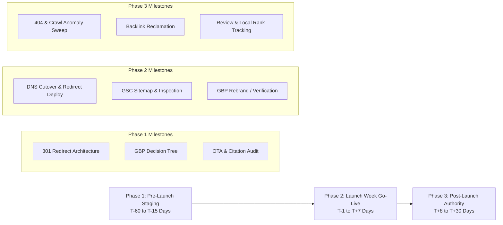
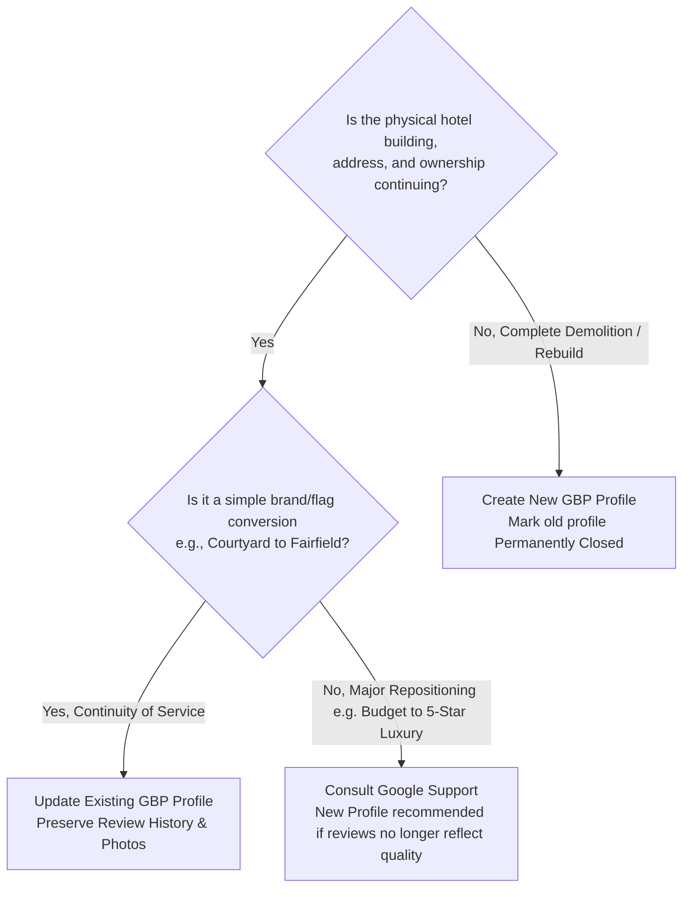

# Hotel Opening, Conversion & Flag-Change SEO Migration Playbook

A structured, 90-day phased migration framework for hotel openings, corporate brand conversions (e.g., Independent to Marriott Autograph Collection, or DoubleTree to Hilton Garden Inn), and property re-flagging. Prevents organic revenue collapse, eliminates 404 link rot, protects legacy backlink equity, and establishes local entity authority.

---

## 1. 90-Day Migration Timeline Overview

---

## 2. Phase 1: Pre-Launch & Technical Staging (T-60 to T-15 Days)

### 2.1 Legacy URL 1:1 301 Redirect Mapping Architecture
*Never redirect all legacy URLs to the new homepage.* A generic wildcard redirect to the root domain dilutes topical relevance and triggers Google Soft 404 penalties. Map legacy URLs to their exact semantic equivalents on the new brand domain.

| Legacy URL (Pre-Conversion) | New Destination URL (Post-Conversion) | HTTP Status | Content & Keyword Parity Check |
|---|---|---|---|
| `{{legacyDomain}}/` | `{{newCanonicalUrl}}/` | `301 Permanent` | Primary brand name + destination overview |
| `{{legacyDomain}}/rooms/` | `{{newCanonicalUrl}}/rooms/` | `301 Permanent` | Room types, suite sizes, bedding configurations |
| `{{legacyDomain}}/rooms/king-suite/` | `{{newCanonicalUrl}}/rooms/king-bed-suite/` | `301 Permanent` | Specific room tier specifications |
| `{{legacyDomain}}/dining/` | `{{newCanonicalUrl}}/dining/` | `301 Permanent` | On-site restaurant name, menu, service hours |
| `{{legacyDomain}}/meetings-events/` | `{{newCanonicalUrl}}/meetings/` | `301 Permanent` | Square footage, floor plans, RFP form |
| `{{legacyDomain}}/weddings/` | `{{newCanonicalUrl}}/weddings/` | `301 Permanent` | Reception space, catering minimums |
| `{{legacyDomain}}/location/` | `{{newCanonicalUrl}}/map-directions/` | `301 Permanent` | Landmark proximity, airport directions |
| `{{legacyDomain}}/special-offers/` | `{{newCanonicalUrl}}/offers/` | `301 Permanent` | Direct booking perks, seasonal packages |

### 2.2 Google Business Profile: Rebrand vs. New Profile Decision Tree
When a hotel undergoes a flag change, mismanaging Google Business Profile can erase hundreds of 5-star reviews or trigger an immediate duplicate listing suspension.

#### Rebrand vs. New Listing Operational Rules:
1. **Scenario A: Standard Flag Conversion (Retain Profile)**
   - *Example*: An independent boutique hotel joins Hilton Tapestry Collection.
   - *Action*: Update the existing listing name to `{{newHotelName}}`, update the website button to `{{newCanonicalUrl}}`, and revise categories. Existing reviews, review responses, and photo views are preserved.
2. **Scenario B: Complete Demolition or Radical Tier Pivot (New Profile)**
   - *Example*: A 2-star roadside motel is demolished and replaced with a newly built luxury JW Marriott.
   - *Action*: Mark the legacy profile as "Permanently Closed". Create and verify a fresh Google Business Profile for `{{newHotelName}}` to prevent historical budget-motel complaints from depressing initial luxury ranking.

### 2.3 Pre-Launch Milestone Checklist
- [ ] **Full Legacy Site Crawl**: Run a comprehensive Screaming Frog / Site Crawl export of `{{legacyDomain}}` capturing all 200 OK HTML URLs, PDFs, and high-equity images.
- [ ] **Backlink Inventory Audit**: Pull top referring domains from Semrush/Ahrefs for `{{legacyDomain}}` to identify external press, CVB links, and partner features that require direct manual outreach.
- [ ] **Staging Tag & Robots Check**: Ensure the new brand.com staging environment does not have leftover `<meta name="robots" content="noindex">` directives prior to DNS cutover.
- [ ] **Google Search Console Property Setup**: Verify both Domain Properties (`{{legacyDomain}}` and the new domain/path `{{newCanonicalUrl}}`) in GSC.

---

## 3. Phase 2: Launch Week / Go-Live Execution (T-1 to T+7 Days)

### 3.1 DNS Cutover & Redirect Implementation
1. **Deploy Server-Side 301 Redirects**: Execute Nginx, Apache, or Cloudflare edge rules forwarding `{{legacyDomain}}` URLs to `{{newCanonicalUrl}}` targets.
2. **Test Redirect Chains**: Verify that legacy URLs resolve directly to destination URLs in a single hop (HTTP 200) without redirect loops or intermediate 302 temporary redirects.
3. **Change of Address Tool (If Standalone Domain Changed)**:
   - If migrating from one vanity domain to another (e.g. `thegrandhotel.com` to `grandhotelcity.com`), submit the official **Change of Address** request in Google Search Console.
   - *(Note: If migrating from a standalone domain to a brand.com subfolder e.g. `marriott.com/hotels/...`, the GSC Change of Address tool is unavailable; Google relies entirely on 1:1 301 redirects and XML sitemaps).*

### 3.2 Primary Citation Ecosystem Cutover
Submit brand name, canonical URL, and category updates simultaneously across primary channels:
- [ ] **Google Business Profile**: Update business name, website URL (with UTM tracking: `?utm_source=google&utm_medium=organic&utm_campaign=gbp`), primary category, and hotel description.
- [ ] **Apple Maps / Apple Business Connect**: Submit official rebrand documentation, exterior signage photos, and updated reservation URL.
- [ ] **TripAdvisor Management Center**: Submit an official "Property Rebrand / Ownership Change" ticket. Provide proof of new brand affiliation (franchise agreement or utility bill) to update property header and maintain ranking integrity.
- [ ] **Bing Places for Business**: Synchronize updated profile data from Google Business Profile or update manually.
- [ ] **Major OTAs (Expedia Partner Central & Booking.com Partner Hub)**: Confirm property name matches brand.com naming conventions to prevent distribution inventory mismatches.

### 3.3 Search Console Indexation & Verification Tasks
- [ ] **Submit New XML Sitemap**: Submit the updated sitemap URL (`{{newCanonicalUrl}}/sitemap.xml`) in Google Search Console.
- [ ] **Inspect Key Landing Pages**: Use the GSC URL Inspection tool to request indexing for the Homepage, Rooms Overview, Meeting RFP, and Location pages.
- [ ] **JSON-LD Schema Validation**: Test the live page with Google's Rich Results Test tool to confirm valid `Hotel`, `PostalAddress`, and `GeoCoordinates` markup.

---

## 4. Phase 3: Post-Launch Stabilization & Authority (T+8 to T+30 Days)

### 4.1 Crawl Error & 404 Anomaly Audit
Perform weekly diagnostics during the first 30 days of operation:
1. **Google Search Console Page Indexing Report**:
   - Filter for "Not Found (404)" and "Soft 404" errors. Identify any legacy traffic paths missed during initial redirect mapping.
2. **Server Access Log Audit**:
   - Inspect server access logs for high-frequency 404 requests from search engine bots. Add missing 1:1 301 redirect rules immediately.
3. **Internal Broken Link Check**:
   - Verify that all navigation menus, footer links, and promotional banners on the new site point to live 200 OK pages with zero internal redirects.

### 4.2 High-Authority Backlink Reclamation
External editorial links carry domain authority that search engines take weeks to transfer through 301 redirects. Update high-priority links directly:
- [ ] **Municipal Tourism Bureau (CVB) & Chamber of Commerce**: Contact regional destination marketing organizations to update directory listings, website links, and event venue descriptions.
- [ ] **Local Airport & Transit Portals**: Update lodging directory links on official airport authority portals (`{{airportName}}`).
- [ ] **Adjacent Convention Center & Sports Arena Websites**: Update preferred lodging and partner hotel pages.

### 4.3 Review Generation & Reputation Re-Anchoring
Accelerate positive entity signals to establish the new brand flag in local search:
- [ ] **Post-Stay Email Review Links**: Configure automated post-departure emails directing satisfied direct bookers to the newly rebranded Google Business Profile.
- [ ] **Review Response Protocol**: Ensure 100% of incoming reviews on the rebranded profile receive personalized, keyword-grounded responses within 24 hours.
- [ ] **Weekly GBP Posts**: Publish weekly Google Posts highlighting newly renovated rooms, brand loyalty benefits (`{{loyaltyProgram}}`), and direct booking guarantees.
