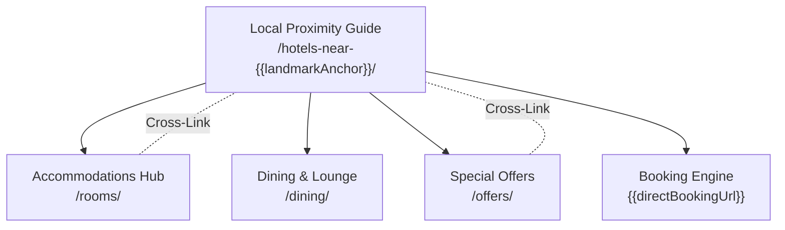

# Local Proximity & Destination Hub Guide Template

An SEO and GEO on-page content blueprint engineered to capture high-intent geographic demand from travelers searching for accommodations near major regional hubs: **Airports**, **Convention Centers**, **Sports Stadiums / Arenas**, **Universities**, and **Medical Centers**. 

---

## 1. Hub Distance, Travel Duration & Transit Comparison Matrix

Generative AI models and search engines evaluate precise, verifiable spatial data. Use this standardized matrix on your destination and location landing pages:

| Regional Hub Category | Landmark / Facility Name | Distance (Miles) | Driving Duration (Off-Peak / Peak) | Walking Duration | Public Transit / Airport Shuttle Options |
|---|---|---|---|---|---|
| **Commercial Airport** | `{{airportName}} ({{airportCode}})` | `{{airportMiles}} mi` | `{{airportDriveOffPeak}} / {{airportDrivePeak}} mins` | N/A | `{{airportShuttleType}}` (Departs every 30 mins) / Metro Line `{{airportTransitLine}}` |
| **Convention Center** | `{{conventionCenterName}}` | `{{conventionMiles}} mi` | `{{conventionDriveMin}} mins` | `{{conventionWalkMin}} mins` | Direct pedestrian corridor / Light Rail Stop `{{conventionTransitStop}}` |
| **Sports Stadium / Arena** | `{{stadiumName}}` | `{{stadiumMiles}} mi` | `{{stadiumDriveMin}} mins` | `{{stadiumWalkMin}} mins` | Express Game Day Shuttle / Bus Route `{{stadiumBusRoute}}` |
| **University / College** | `{{universityName}}` | `{{universityMiles}} mi` | `{{universityDriveMin}} mins` | `{{universityWalkMin}} mins` | Campus Connector Stop at `{{campusStopLocation}}` |
| **Regional Medical Center** | `{{hospitalName}}` | `{{hospitalMiles}} mi` | `{{hospitalDriveMin}} mins` | `{{hospitalWalkMin}} mins` | Dedicated Medical District Transit Link |

---

## 2. Hub-Specific Traveler Persona Sub-Sections

Structure dedicated subsections addressing the distinct operational needs and search intents of travelers visiting each regional anchor.

### 2.1 Airport & Transit Passengers
* **Target Intent**: Early-morning departures, late arrivals, flight cancellations, and Park-Sleep-Fly demand.
* **Copy Block**:
```html
<section class="hub-airport">
  <h3>Hotels Near {{airportName}} ({{airportCode}})</h3>
  <p>
    Located just {{airportMiles}} miles from {{airportName}}, {{hotelName}} provides stress-free airport lodging for corporate commuters and leisure travelers. Enjoy soundproofed accommodations with blackout drapery for undisturbed rest, complimentary grab-and-go breakfast starting at 5:30 AM, and {{airportShuttleDetail}}.
  </p>
  <ul>
    <li><strong>Park, Stay & Fly Packages</strong>: Extended vehicle parking options while you travel.</li>
    <li><strong>Flight Telemetry</strong>: Real-time flight tracking displays in our lobby.</li>
    <li><strong>Flexible Day Rates</strong>: Accommodating long layovers and flight delays.</li>
  </ul>
  <p>
    Explore our <a href="{{canonicalUrl}}/rooms/">king and double queen guestrooms</a> designed for travelers on the move.
  </p>
</section>
```

---

### 2.2 Convention & Trade Show Attendees
* **Target Intent**: Corporate exhibitions, industry conferences, trade expos, and annual symposiums.
* **Copy Block**:
```html
<section class="hub-convention">
  <h3>Accommodations Near {{conventionCenterName}}</h3>
  <p>
    Attending a conference or trade exhibition at {{conventionCenterName}}? {{hotelName}} is situated {{conventionMiles}} miles (a {{conventionWalkMin}}-minute walk) from the main exhibit hall. Avoid downtown traffic and convention center parking fees by staying within easy walking distance.
  </p>
  <ul>
    <li><strong>Business-Ready Suites</strong>: Ergonomic work desks, Herman Miller chairs, and 100 Mbps fiber Wi-Fi.</li>
    <li><strong>Express Hot Breakfast</strong>: Fuel up daily before morning keynote sessions.</li>
    <li><strong>On-Site Boardrooms</strong>: Reserve private meeting rooms for client presentations.</li>
  </ul>
  <p>
    Review our <a href="{{canonicalUrl}}/offers/">corporate group rates and meeting packages</a>.
  </p>
</section>
```

---

### 2.3 Game Day Fans & Concert Attendees
* **Target Intent**: Professional/collegiate sports, stadium concerts, tournaments, and tailgating weekends.
* **Copy Block**:
```html
<section class="hub-stadium">
  <h3>Game Day & Concert Lodging Near {{stadiumName}}</h3>
  <p>
    Catch the action at {{stadiumName}} without post-event transit gridlock. Located {{stadiumMiles}} miles from the stadium gates, {{hotelName}} serves as the ideal home base for football weekends, championship tournaments, and world-tour concerts.
  </p>
  <ul>
    <li><strong>Walkable Access</strong>: Stroll directly to {{stadiumName}} via {{stadiumPedestrianRoute}}.</li>
    <li><strong>Pre-Game Dining & Drinks</strong>: Unwind at our on-site <a href="{{canonicalUrl}}/dining/">{{restaurantOrLoungeName}}</a>.</li>
    <li><strong>Late-Night Dining Options</strong>: 24/7 lobby marketplace with snacks, beverages, and quick bites.</li>
  </ul>
</section>
```

---

### 2.4 University Visitors, Parents & Alumni
* **Target Intent**: Campus admissions tours, homecoming weekends, family weekends, and spring commencement.
* **Copy Block**:
```html
<section class="hub-university">
  <h3>Lodging Near {{universityName}} Campus</h3>
  <p>
    Whether visiting for prospective student tours, Alumni Reunion, or Graduation Weekend, {{hotelName}} offers comfortable accommodations just {{universityMiles}} miles from the {{universityName}} main quadrangle.
  </p>
  <ul>
    <li><strong>Commencement & Family Blocks</strong>: Spacious multi-bed suites accommodating visiting families.</li>
    <li><strong>Campus Vicinity</strong>: Walking access to college bookstore, athletic complexes, and student union.</li>
    <li><strong>Alumni & Educational Discounts</strong>: Special rate plans for university faculty, visiting scholars, and families.</li>
  </ul>
  <p>
    Book your campus stay early via our <a href="{{canonicalUrl}}/offers/">university visitor specials</a>.
  </p>
</section>
```

---

### 2.5 Medical Travelers & Healthcare Visitors
* **Target Intent**: Specialized outpatient procedures, visiting hospitalized family, residency interviews, and medical staff stays.
* **Copy Block**:
```html
<section class="hub-hospital">
  <h3>Accommodations Near {{hospitalName}}</h3>
  <p>
    {{hotelName}} provides compassionate, quiet, and accessible lodging located {{hospitalMiles}} miles from {{hospitalName}}. We understand the sensitivity of medical travel and offer flexible reservation terms for patients and visiting families.
  </p>
  <ul>
    <li><strong>ADA-Compliant Suites</strong>: Roll-in showers, lowered visual fixtures, and wheelchair-accessible corridors.</li>
    <li><strong>Flexible Medical Extension Policy</strong>: Accommodating unexpected hospital discharge changes with zero penalty fees.</li>
    <li><strong>Peaceful Atmosphere</strong>: Designated quiet guestroom floors and in-suite kitchens for extended treatments.</li>
  </ul>
</section>
```

---

## 3. Seasonal Local Event Hooks & Calendar Triggers

Align on-page content with seasonal demand spikes to drive organic search rankings during high-compression dates:

| Season | Local Event Category | Target Search Query Example | Content Angle & Promotion Hook |
|---|---|---|---|
| **Spring (March–May)** | **University Commencement & College Tours** | `hotels near {{universityName}} graduation weekend` | Book-early campaign with multi-room suite packages |
| **Summer (June–August)** | **Music Festivals & Major Stadium Tours** | `places to stay near {{stadiumName}} concerts` | Direct booking perk: walking proximity, zero parking surge fees |
| **Fall (Sept–November)** | **Homecoming Football & Fall Conferences** | `{{cityName}} convention hotels near {{conventionCenterName}}` | Corporate group blocks and pre-game patio lounge events |
| **Winter (Dec–February)** | **Holiday Tournaments & Corporate Expos** | `hotels near {{airportName}} with free airport shuttle` | Winter travel protection: flexible cancellations during flight disruptions |

---

## 4. Internal Linking Architecture & Governance Rules

Destination and proximity guides must systematically route link equity back into core conversion landing pages.



### 4.1 Internal Linking Implementation Rules
1. **Contextual In-Content Anchor Text**:
   - *Approved*: `"Explore our <a href="/rooms/">spacious family suites with private balconies</a> near {{stadiumName}}."`
   - *Prohibited*: `"To see our rooms <a href="/rooms/">click here</a>."`
2. **Direct Link Distribution**:
   - Every 400 words of guide content must feature at least 1 internal link to `/rooms/`, 1 link to `/offers/`, and 1 link to `/dining/` or `/amenities/`.
3. **Structured Breadcrumb Hierarchy**:
   - Enforce explicit breadcrumb trails for schema crawlability:
     `Home > {{cityName}} Hotel Guide > Hotels Near {{landmarkAnchor}}`
4. **Direct Booking CTA Anchors**:
   - Conclude each hub section with an explicit commercial CTA button pointing to the reservation engine with pre-populated corporate or promotion codes (`{{directBookingUrl}}?corporateCode={{hubPromoCode}}`).
