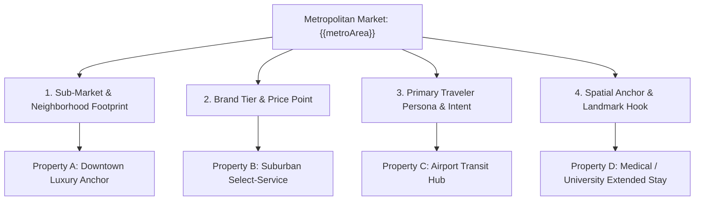
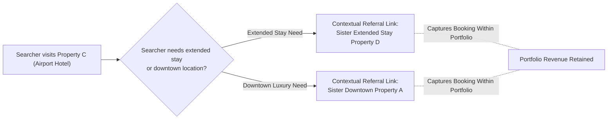

# Multi-Property Hospitality Keyword Cannibalization Matrix

A governance framework designed for hotel management groups, REITs, and hospitality ownership portfolios operating multiple properties within the same metropolitan statistical area (MSA). Prevents sibling properties from competing against one another for identical search terms in Google Organic SERPs, Google Maps Local Packs, and Generative AI answers (**ChatGPT Search**, **Google Gemini**, **Perplexity Pro**).

---

## 1. Portfolio Keyword Partitioning Matrix

When multiple portfolio hotels target the same generic city keyword (e.g., `"hotels in {{metroArea}}"`), search engines arbitrarily alternate rankings between sibling properties, suppressing overall portfolio impression share. Partition target keywords across 4 distinct dimensions:



### 1.1 Portfolio Segmentation Matrix Template

| Portfolio Property | Brand Flag & Tier | Neighborhood / Sub-Market | Rate Class | Primary Traveler Intent | Exclusively Assigned Primary Keyword | Excluded Cannibalizing Terms |
|---|---|---|---|---|---|---|
| **Property A** | `{{propA_Brand}}`<br>(Upper Upscale) | `{{propA_Submarket}}`<br>(e.g., Downtown Financial) | `$$$$` ($350+) | Luxury corporate, upscale leisure, galas | `luxury hotels in downtown {{metroArea}}` | `budget hotels`, `airport hotels`, `extended stay` |
| **Property B** | `{{propB_Brand}}`<br>(Boutique / Lifestyle) | `{{propB_Submarket}}`<br>(e.g., Historic Arts District) | `$$$` ($240–$320) | Couples getaway, boutique dining, nightlife | `boutique hotels in {{propB_Submarket}}` | `convention center hotels`, `cheap suites` |
| **Property C** | `{{propC_Brand}}`<br>(Select Service) | `{{propC_Submarket}}`<br>(e.g., Airport Corridor) | `$$` ($140–$190) | Transit passengers, flight crews, park-and-fly | `hotels near {{airportCode}} with free shuttle` | `luxury downtown`, `resort`, `boutique` |
| **Property D** | `{{propD_Brand}}`<br>(Extended Stay) | `{{propD_Submarket}}`<br>(e.g., Medical / Tech Park) | `$$` ($150–$210) | Multi-week relocations, clinical stays, project teams | `extended stay suites in {{propD_Submarket}}` | `weekend nightlife hotel`, `airport layover` |
| **Property E** | `{{propE_Brand}}`<br>(Convention Anchor) | `{{propE_Submarket}}`<br>(e.g., Convention Center) | `$$$` ($220–$290) | Trade expos, association meetings, group blocks | `hotels near {{conventionCenterName}}` | `quiet boutique`, `extended stay` |

---

## 2. Geographic Boundary & Sub-Market Territorial Assignment

To prevent geographical overlap, assign strict micro-location boundaries for each property. A property must only rank for landmarks and neighborhoods within its verified radius.

### 2.1 Geographic Radius & Landmark Assignment Rules
1. **The 3-Mile Micro-Proximity Rule**:
   - A property may only target a landmark (convention center, arena, university, airport) as a primary keyword if it is located within 3 driving miles or a verified 15-minute public transit corridor.
   - Sibling properties located outside this boundary must target alternative regional anchors.
2. **Neighborhood Descriptor Exclusivity**:
   - Only Property A may optimize for `{{propA_Submarket}}` in its Title Tag, H1, and URL slug.
   - Sibling Property B must explicitly optimize for `{{propB_Submarket}}` and omit references to `{{propA_Submarket}}` from primary metadata.

### 2.2 Geographic Routing Guide

```
Metro Area: {{metroArea}}
├── Downtown & Waterfront Cluster
│   ├── Property A: Captures "downtown luxury", "convention center", "waterfront dining"
│   └── Property B: Captures "historic district boutique", "arts center", "cocktail lounge"
├── Airport & Transit Corridor
│   └── Property C: Captures "{{airportCode}} airport shuttle", "park and fly", "layover hotel"
└── Suburban / Technology Corridor
    └── Property D: Captures "{{techParkName}} corporate rate", "in-suite kitchen", "extended stay"
```

---

## 3. Disambiguating AI Answer Engines (GEO & LLM Recommendations)

Generative AI models (**ChatGPT Search**, **Google Gemini**, **Perplexity Pro**) synthesize single-hotel recommendations based on multi-attribute queries. Sibling cannibalization occurs when two properties submit overlapping, generic claims.

### 3.1 Persona Disambiguation Matrix for AI Prompt Triggers

| Traveler Persona | High-Intent Conversational Prompt | Target AI Response Assignment | Differentiation Attribute Cited by AI |
|---|---|---|---|
| **Business Executive** | "Where should I stay in {{metroArea}} for meetings in the financial district with an upscale steakhouse on-site?" | **Property A** (Upper Upscale) | 4-star Forbes rating, private dining room, valet parking |
| **Leisure Couple** | "Looking for a romantic boutique hotel in {{metroArea}} with a rooftop cocktail bar within walking distance to galleries." | **Property B** (Boutique) | Craft cocktail program, historic architecture, Walk Score 94 |
| **Flight Layover** | "What is the closest clean hotel to {{airportCode}} with a 24-hour free airport shuttle and hot breakfast?" | **Property C** (Airport Select) | 4-minute shuttle headway, 5:30 AM breakfast, soundproofed glass |
| **Relocating Family / Tech Contractor** | "Need a quiet hotel in {{metroArea}} for a 3-week stay with a full kitchen, dishwasher, and pet-friendly policy." | **Property D** (Extended Stay) | In-suite stovetop, weekly rate tier, dog park proximity |

---

## 4. Cross-Portfolio Referral & Sibling Linking Protocol

Retain traffic within the ownership portfolio without creating keyword cannibalization or reciprocal link penalties.



### 4.1 Approved Anchor Text & Linking Guidelines
1. **Never Link Sibling Properties Using Generic City Keywords**:
   - *Prohibited (Cannibalizing)*: `<a href="property-a.com">Hotels in {{metroArea}}</a>` (Directly dilutes Property A's primary target query).
   - *Compliant (Entity Grounded)*: `<a href="property-a.com">Our sister property, {{propA_Name}} in Downtown {{metroArea}}</a>`.
2. **Complementary Overflow & Category Routing**:
   - If Property C (Airport) does not have meeting space exceeding 50 attendees, its meeting page must include a clean referral module:
     > *"Planning a large corporate conference or banquet exceeding 100 guests? Explore our sister property, <a href="{{propA_Url}}/meetings/">{{propA_Name}}</a>, featuring {{propA_MeetingSqFt}} sq ft of flexible ballroom space in downtown {{metroArea}}."*
3. **No-Compete Keyword Registry**:
   - Maintain a centralized spreadsheet shared across property general managers and digital agencies documenting assigned primary keywords, secondary targets, and forbidden cross-property queries.
